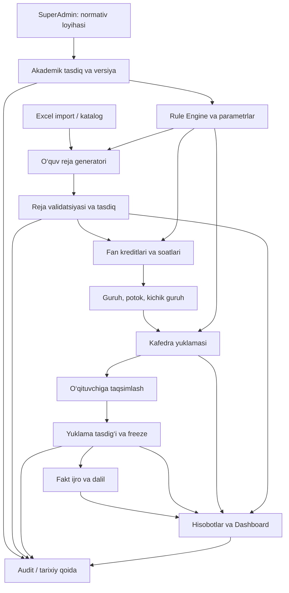
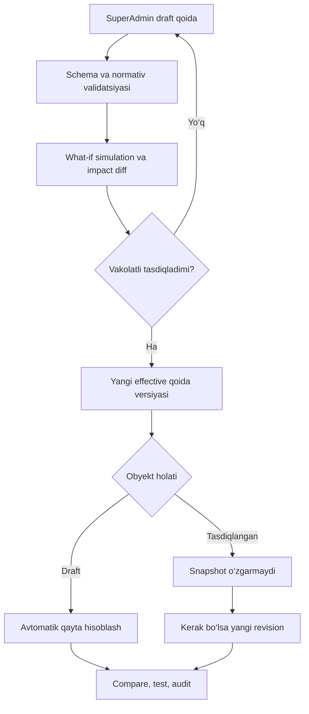
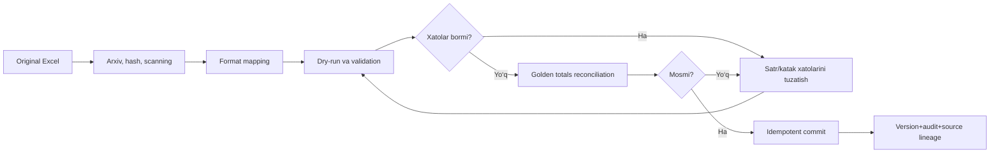

# O‘QUV BO‘LIMI ERP — YAKUNIY MASTER TEXNIK TOPSHIRIQ

**Tayyorlangan sana:** 2026-10-28  
**Maqom:** Codex uchun loyihalash paketi (hali tayyor dastur emas).  
**Doira:** faqat O‘quv bo‘limi, Registrator va talaba arizalari kirmaydi.

---


---

<!-- FILE: README.md -->


# O‘quv bo‘limi ERP — Codex uchun loyiha paketi

**Versiya:** 1.0 (konseptual texnik topshiriq)  
**Sana:** 2026-10-28  
**Qo‘llanish sohasi:** faqat universitet O‘quv bo‘limi; Registrator ofisi va talaba arizalari loyiha doirasidan tashqarida.

## Natija
Hozirgi Excel ish jarayonlarini bosqichma-bosqich, izohlanadigan, versiyalangan va nazorat qilinadigan web-platformaga o‘tkazish. Asosiy yadro: me’yorlar → tasdiqlangan o‘quv reja → fan soatlari → kafedra yuklamasi → o‘qituvchi yuklamasi → ijro → hisobot.

## Hujjatlarni o‘qish tartibi
1. `docs/01-TTZ.md` — to‘liq texnik topshiriq, rol/modul chegarasi.
2. `docs/02-HISOBLASH-QOIDALARI.md` — hisoblash formulalari, me’yorlar, o‘zgarish va versiyalar.
3. `docs/03-MALUMOTLAR-BAZASI.md` — domen modeli, jadvallar, cheklovlar.
4. `docs/04-API-VA-JARAYONLAR.md` — API, oqimlar va statuslar.
5. `docs/05-EXCEL-MIGRATSIYA.md` — eski Excel'dan xatarsiz ko‘chirish.
6. `docs/06-XAVFSIZLIK-VA-DEVOPS.md` — xavfsizlik, test va ekspluatatsiya.
7. `docs/07-CODEX-REJA.md` — Codex bilan ketma-ket amalga oshirish uchun aniq promptlar.
8. `docs/08-QABUL-TESTLARI.md` — tugallangan deb topish shartlari.
9. `docs/09-INTERFEYS.md` — ekranning tuzilishi va UX.
10. `docs/10-ANIQLASHTIRISH.md` — haqiqiy Excel namunalaridan aniqlanishi shart bo‘lgan narsalar.
11. `docs/11-SUPERADMIN-PARAMETRLAR.md` — SuperAdmin boshqaradigan parametrlarning to‘liq katalogi.
12. `docs/12-ARXITEKTURA-SXEMA.md` — Mermaid formatidagi arxitektura va jarayon sxemalari.
13. `CODEX_START_HERE.md` — Codex uchun birinchi tayyor prompt.
11. `AGENTS.md` — Codex agenti uchun doimiy muhandislik qoidalari.
12. `config/rules.example.json` va `fixtures/demo-scenario.json` — **faqat DEMO** hisoblash sozlamalari va test misoli.

## Ishni boshlash
1. O‘quv bo‘limidagi haqiqiy Excel fayllar va tasdiqlangan me’yorlarni (maxfiy ma’lumotlari tozalangan nusxalarda) yig‘ing.
2. `docs/10-ANIQLASHTIRISH.md` dagi ochiq savollarni belgilab chiqing.
3. Codex'ga ushbu papkani bering va `docs/07-CODEX-REJA.md` bo‘yicha **har bosqichni alohida** bajartiring.
4. Har sprintdan so‘ng testlar, migratsiya, xavfsizlik tekshiruvi va namuna Excel bilan reconciliation bo‘lmasa keyingi sprintga o‘tmang.

## Hujjat maqomi
Bu **Codex uchun bajariladigan loyiha spetsifikatsiyasi**, ishlab turgan tayyor ERP emas. Real universitetdagi hisoblash natijalarini 100% moslashtirish uchun Excel namunalar, ichki qoidalar, rasmiy o‘quv reja shablonlari va vakolatlar matriksasi talab qilinadi.

## Normativ ma'lumotnomalar
- Kredit-modul: https://lex.uz/uz/acts/-5193564
- Professor-o‘qituvchi yuklamasi: https://lex.uz/uz/acts/-3967278
- Oliy ta’lim to‘g‘risidagi nizom (2026): https://lex.uz/uz/acts/-8117474
- Shaxsga doir ma’lumotlar: https://lex.uz/uz/acts/-4396419
- OWASP ASVS: https://asvs.owasp.org/
- WCAG 2.2: https://www.w3.org/TR/WCAG22/

**Eslatma:** Qonunchilikning amaldagi tahriri va universitet uchun tatbiq etilishi ishlab chiqish vaqtida mas’ul yuridik/o‘quv mutaxassislar tomonidan yana tekshiriladi; qoidadagi demo sonlar huquqiy me’yor sifatida qabul qilinmaydi.


---

<!-- FILE: AGENTS.md -->


# Codex agent instructions — O‘quv bo‘limi ERP

1. Read `README.md`, `docs/01-TTZ.md`, `docs/02-HISOBLASH-QOIDALARI.md`, `docs/08-QABUL-TESTLARI.md` BEFORE writing code.
2. SCOPE: university O‘quv bo‘limi ONLY. Do NOT add Registrator ofisi, student applications, expulsions, fee accounting, full LMS.
3. Production calculations MUST use approved, versioned, effective-dated rules. NEVER hardcode an assumed legally required hours/credits/staff workload. Demo fixture config is NOT production default.
4. Student study hours, contact hours, departmental teaching demand, teacher allocation and verified actual hours are DIFFERENT measures. Maintain explicit types and units.
5. Use decimal-safe arithmetic, explicit rounding, no JS floating-point accounting, no `eval`/untrusted executable rule expressions.
6. All business records have source lineage, version, audit, permission checks. Approved reports/curricula and historical years are immutable snapshots.
7. SuperAdmin creates rule drafts; distinct academically authorized approver activates them. Four-eyes wherever institution policy requires.
8. No silent import. Excel input: classify, map, validate, preview, reconcile, commit. Macro execution prohibited. Import/export idempotent.
9. Modular-monolith boundary: domain services + pure calculation library + audited workflows + worker queue + PostgreSQL + OpenAPI.
10. No untested code. Add unit, integration, permission, E2E and golden Excel tests appropriate to every feature.
11. Source code, docs, UI text in coherent style. Default locale Uzbek Latin, timezone Asia/Tashkent, internal UTC.
12. Before each sprint: explain scope and assumptions; after: summary, tests run, limitations, new risks, blockers and accepted criteria.
13. If institutional Excel, law, curricula or approval authority are unknown, STOP that specific production rule and mark `BLOCKED`; don't invent numbers.
14. Do not place real personal data, passwords or private Excel attachments in repository fixtures or logs.
15. Prefer simple, explainable, testable logic over black-box ML/AI; assigners/solvers give auditable recommendations only.


---

<!-- FILE: CODEX_START_HERE.md -->


# Codex'da birinchi topshiriq — nusxalab yuborish uchun

Quyidagi promptni ushbu loyiha paketi bilan birga Codex ishchi repozitoriyasida yuboring:

> `README.md`, `AGENTS.md` va `docs/01...12` dagi barcha loyiha hujjatlarini o‘qib chiq. Bu universitetning faqat O‘quv bo‘limi uchun maxsus ERP. Registrator ofisi, talaba arizalari, buxgalteriya va to‘liq LMS qurmaysan. Hozirgi asosiy ishlar Excel'da qo‘lda olib boriladi. Asosiy maqsad: me’yorlar (SuperAdmin draft + vakolatli akademik tasdiq) → o‘quv reja → fan soatlari → kafedra yuklamasi → o‘qituvchi yuklamasi → ijro → hisobot/dashboard. Hisoblar faqat tasdiqlangan, effective-dated, versioned qoida bilan ishlasin. Talaba mustaqil ta’lim soatlarini o‘qituvchi dars yuklamasiga qo‘shma. Hozir birinchi navbatda Sprint 00 va Sprint 01 ni bajarmoqchiman: avval repo strukturasi va arxitektura qarorlarini yoz, so‘ng modern monorepo skeleton + PostgreSQL + NestJS API + Next.js UI + local Docker dev + role/scope auth + audit + CI + smoke tests yarat. Production sonlarni taxmin qilib qo‘shma, demo parametrlarni faqat test fixture’da saqla. Har o‘zgarish uchun tests, OpenAPI, DB migration, RBAC, Uzbek UI va README bo‘lsin. Har sprint oxirida bajarilgan ishlar, test natijasi va bloklovchi noma’lum narsalarni chiqar.
**Muhim:** Anonimlashtirilgan haqiqiy Excel fayllar va ichki me’yorlar kiritilmaguncha Codex ishlab chiqargan dastur faqat skeleton/demo; hisoblar rasmiy ishlatishga tayyor emas.


---

<!-- FILE: docs/01-TTZ.md -->


# 01. Tizimning to‘liq texnik topshirig‘i (TTZ / PRD)

## 1.1. Maqsad va loyiha doirasi
**Mahsulot:** `O‘quv bo‘limi ERP` (ishchi nom).  
**Mijoz:** universitet O‘quv bo‘limi.  
**Maqsad:** Excelga bog‘langan takrorlanuvchi o‘quv rejalashtirish, fan-soatlari hisobi, o‘qituvchi yuklamasi, ijro monitoringi, kafedra/fakultet hisobotlari va rahbar panelini bir tizimda yuritish.

**Kirmaydi:** Registrator ofisi; talaba arizalari; chetlashtirish/tiklash; to‘lov-kontrakt; baholarni qo‘lda yuritish; diplom; buxgalteriya; to‘liq LMS; abituriyent qabuli. Talaba soni faqat normativ guruhlash/yuklama uchun umumlashgan ma’lumot sifatida ishlatilishi mumkin.

**Bosh prinsiplari:** (a) manba ma’lumotni qayd qilish, (b) deterministik hisoblash, (c) kelishish va tasdiqlash, (d) o‘zgarmas tasdiqlangan snapshot, (e) audit, (f) eksport/import mosligi.

## 1.2. Kim foydalanadi va vakolatlar
1. **SuperAdmin (texnik):** tizim konfiguratsiyasi, foydalanuvchi va rol huquqlari, me’yor loyihasini kiritish, import sxemasi, integratsiya sozlamalari; o‘z-o‘zidan normativni akademik tasdiqlay olmaydi.
2. **O‘quv ishlari bo‘yicha prorektor / vakolatli tasdiqlovchi:** o‘quv reja va yillik yuklama versiyalarini tasdiqlash, umumiy dashboard, normativ o‘zgarishlariga akademik rozilik.
3. **O‘quv bo‘limi boshlig‘i:** reja, hisobot, kafedralar yuborgan ma’lumotlar, konfliktlar va monitoring; yakuniy ko‘rib chiqish.
4. **O‘quv bo‘limi mutaxassisi/rejalashtiruvchi:** o‘quv reja loyihasi, fanlar, akademik kalendar, guruhlar, yuklama loyihasi, import tuzatishlari.
5. **Fakultet mas’uli:** faqat tegishli fakultet kesimida ma’lumot ko‘radi/kiritadi, kafedra hisobotlarini ko‘rib chiqadi.
6. **Kafedra mudiri/mas’uli:** kafedra fanlari va o‘qituvchilari, yuklama taqsimoti loyihasi, fakt ijro dalillari va kafedra hisobotlari.
7. **O‘qituvchi:** faqat o‘ziga biriktirilgan yuklama va ijro ko‘rinishi; dalillarni yuborish (agar vakolat berilsa).
8. **Auditor (read-only):** barcha tasdiqlangan versiyalar, audit va solishtirish; maxfiy maydonlar ruxsatga ko‘ra maskalanadi.
9. **Servis integratsiyasi:** faqat aniq ruxsat berilgan API/import operatsiyalari, alohida texnik identifikator.

**Har bir so‘rovda:** foydalanuvchining rolidan tashqari uning fakultet/kafedra doirasi, hujjat holati va akademik yil tekshiriladi. SuperAdmin ham auditni o‘chira olmaydi. Ikki bosqichli tasdiqlash (four-eyes) akademik me’yor o‘zgarishlarida majburiy.

## 1.3. Funktsional modullar (to‘liq ko‘lam)
### M01. Akademik ma’lumotnomalar va o‘quv yillari
Universitet → fakultet → kafedra; ta’lim darajasi, shakli, dastur/yo‘nalish kodi, kohorta (qabul yili), semestr, o‘quv yili, fan turlari, kredit birligi, o‘qituvchi lavozimi, toifa, shtat/stavka ma’lumotlari; barcha kataloglarga barqaror kod va tarix.
**Qabul:** bir xil kodni ikki marta qo‘shib bo‘lmasin; eski yillarning kodi o‘zgarmasin; izlanadigan UI.

### M02. SuperAdmin me’yorlari / Rule Engine
Normativ paketi: kredit→soat; ta’lim darajasi/shakliga ko‘ra auditoriya ulushi; fan turi va mashg‘ulot turi; guruh/potok/kichik guruh chegaralari; lavozim va o‘qituvchi yuklama parametrlari; ish turi bo‘yicha koeffitsiyent; yaxlitlash; limitlar; qoida ustuvorligi; kirish/kuchga kirish/amal qilish sanalari. Qoidalarni cheklanmagan `eval` kodida kiritish mumkin emas. JSON-sxema va tasdiqlangan operatorli Rule DSL.
**Qabul:** `draft → review → approved → effective → archived` holatlar; bir-birini qoplovchi faol qoida uchun tekshiruv; diff va qayta hisoblash preview; tasdiqlangan snapshotni in-place o‘zgartirmaslik.

### M03. Fanlar katalogi
Fan ID, kodi, o‘zbek/rus/inglizcha nomi (ixtiyoriy), kategoriyasi (majburiy/tanlov), mas’ul kafedra, kredit diapazoni, oldindan talab fanlari, o‘qitish tili, yo‘nalishga aloqasi, versiyalar, shablonlar, faol/arxiv.
**Qabul:** takror fan/dublikat aniqlanadi; tegishli yo‘nalishda tanlov fanlari savati to‘g‘ri ishlaydi.

### M04. O‘quv rejalar generatori
Ta’lim dasturi, qabul yili, daraja, ta’lim shakli, muddat, akademik semestrlar, fanlar va kreditlar, oldindan talab fanlari, bloklar, amaliyotlar, attestatsiya; shablondan loyihani yaratish; semestrlarga avtomatik taqsimlash uchun cheklovli tavsiya algoritmi (avtomatik 'tasdiq' yo‘q); tasdiqlangan namunaviy reja bilan solishtirish.
**Validatsiya:** har semestr/yil kreditlari; umumiy kredit; majburiy va tanlov balans; oldindan talablar; soatlar yig‘indisi; kasbiy/yo‘nalish talablari; haftalar. Istisnolarni alohida tasdiqlangan qaror bilan qayd qilish. Eksport: universitetning rasmiy Excel/PDF shabloni, format va formulalar bilan mos.

### M05. Fan soatlari generatori
Kredit × soat/kredit = talabaning fan bo‘yicha jami o‘quv soati; auditoriya ulushi → auditoriya va mustaqil ta’lim; mashg‘ulot turlari (ma’ruza, amaliy, seminar, laboratoriya, individual) soatlarini foydalanuvchi qoida/shablon bilan hisoblash; akademik haftalar va juftliklar bo‘yicha reja; yarim semestr/parallel fanlar/kechki-sirtqi-distant format va istisnolarni qo‘llash. Har xil soat kategoriyalarini chalkashtirmaslik.

### M06. Guruh, potok va kichik guruhlar
Guruh kodi, yo‘nalish, bosqich, semestr, talabalar soni (PII'siz), til/shakl, fan uchun kontingent, ma’ruza potoklari, amaliy guruhlar, laboratoriya kichik guruhlar, fakultetlararo birlashtirish qoidasi va chegaralari. Bir talaba kontingentini ikki marta sanamaslik, ko‘rsatkichlar snapshoti.

### M07. Kafedra/o‘qituvchi yuklamasi hisoblash
Fan+semestr+guruh/potok+soat turi asosida mashg‘ulotni ko‘paytirish; 3076 va o‘quv kengashi qaroridagi tegishli darsdan tashqari o‘quv ishlarini **alohida normativ qoida** orqali hisoblash (imtihonlar, yakuniy nazorat, kurs ishi rahbarligi, amaliyot, attestatsiya, boshqa belgilangan ishlar). Natijalar: kafedra buyurtmasi, jami talab, o‘qituvchi nomiga biriktirilgan yuklama; reja/tasdiqlangan/fakt farqi; dublikat dars detektori.
**Eslatma:** shaxsiy ish rejasining metodik/ilmiy/ustoz-shogird bo‘limlari o‘quv soatlariga asossiz qo‘shilmaydi; zarur bo‘lsa alohida ish turlari modulida qayd qilinadi.

### M08. O‘qituvchiga taqsimlash / Constraint Solver
O‘qituvchi malakasi va fan kompetensiyasi, kafedra mansubligi, mavjud yuklama, stavka va lokal limit, ta’til/bandlik, ma’ruza o‘qish vakolati, til, fan va guruh bo‘yicha cheklov, qo‘lda bandlash (lock) va prioritetlar; dastlab deterministik validatsiya/foydalanuvchi tanlovi, keyin optimizer takliflari. Taklif sabablarini ko‘rsatish, haddan tashqari bandlikda blok yoki asoslantirilgan ogohlantirish. Yakuniy qaror insonda.

### M09. Yillik ish rejasi va ijro nazorati
Yillik/choraklik/oylik vazifalar; takrorlanuvchi ish shablonlari; mas’ul, kuzatuvchi, muddat, progress, dalil fayli, qabul qiluvchi, kechikish, eslatmalar, audit. O‘quv bo‘limi ish jarayoniga tegishli topshiriqlar, umumuniversitet HR/task-management emas.

### M10. O‘qitish va yuklama ijrosi monitoringi
Tasdiqlangan reja bo‘yicha mashg‘ulot / dalil / real bajarilgan soatlar; kelmagan/almashtirilgan/ko‘chirilgan dars; manba va tekshiruvchi; reja vs fakt; dalilsiz ish 'bajarildi' hisoblanmasin. Tashqi tizimdan real bajarilish ma’lumoti faqat ruxsat etilgan integratsiya yoki tekshirilgan import bilan.

### M11. Kafedra va fakultet elektron hisobotlari
Hisobot davri, majburiy ko‘rsatkichlar, manbalar, avtomatik hisob, zarur izoh/dalil, submit-review-return-approve, kumulyativ universitet ko‘rinishi, eski versiya va qayta yuborish tarixi. Takror qo‘lda to‘ldirishni minimallashtirish.

### M12. Rahbariyat Dashboard va analitika
O‘quv reja holati, fakultet/kafedra bo‘yicha jami reja va tasdiq, yuklama bajarilishi, normativ og‘ishlar, ochiq konfliktlar, topshiriq kechikishlari, hisobot topshirish vaqti, yillar taqqoslovi, drill-down, filtr va snapshot sanasi. Foiz denominator va yangilanish vaqti ko‘rsatiladi. CSV/XLSX/PDF eksportda ekrandagi filtrlarga mos ma’lumot.

### M13. Excel import/eksport va hujjatlar
.xlsx/.xlsm (makrolar ishga tushirilmasin) import, ruxsat berilgan CSV/XLSX, shablon aniqlash, mapping, preview, validatsiya xatolari, deduplikatsiya, dry-run, atomic commit, rollback/compensating action, manba fayl hash va arxiv; rasmiy Excel maketlari, Word/PDF faqat tasdiqlangan shablonlarda. CSV injectiondan himoyalash.

### M14. Integratsiya, audit va xabarnomalar
Mavjud ichki ma’lumot manbalari/HEMIS faqat tasdiqlangan API va ruxsatlar mavjud bo‘lsa; idempotent pull/push, source-of-truth matriksi va conflict queue; ichki bildirishnomalar/e-mail (opsional), audit jurnal, notifikatsiya shablonlari. Hech qanday integratsiya majburiy faraz qilinmaydi.

### M15. Versiyalar, stsenariylar, qayta hisoblash
`what-if` simulyatsiyasi: SuperAdmin '30 → 29 soat' yoki kontingent `75 → 82` kabi parametr almashtirsa qaysi reja, fan soati, kafedra va o‘qituvchi yuklamasi o‘zgarishi aniq diff bilan chiqadi. Faol tasdiqlangan obyektga bevosita yozish mumkin emas. Yangi loyiha versiyasi hosil qilinadi, review so‘ng publish. Oldingi semestrlar uchun lock va tarixiy eksport ishlashda davom etadi.

### M16. Dars jadvali va auditoriya resurslari (ikkinchi bosqich)
Dars jadvalini yaratish yoki universitetda mavjud jadval manbasidan o‘quv bo‘limi nazorati uchun olish. Fakultet, guruh, o‘qituvchi, auditoriya, hafta, juft/toq hafta, mashg‘ulot turi, xona sig‘imi, texnik jihoz, ta’til va istisnolar bo‘yicha konfliktlarni aniqlash; auditoriyalar bandligi dashboardi. Jadval generatori avtomatik tavsiya beradi, mas’ul tasdiqlaydi. Tasdiqlangan yuklama bilan jadval o‘rtasidagi moslik tekshiriladi. Agar dars jadvallari boshqa bo‘limga tegishli bo‘lsa, read-only integratsiya bilan cheklaniladi.

### M17. Sillabus, fan dasturi va metodik ta’minot nazorati (ikkinchi bosqich)
Fan bo‘yicha sillabus, o‘quv dasturi, kalendar-tematik reja, o‘quv-uslubiy majmua versiyalari; shablon, akademik yil, fan kodi va mas’ul kafedra bilan bog‘lash; mavjudlik, eskirganlik, muddat, ko‘rib chiqish, aprobatsiya/approval holati; o‘quv reja soatlari bilan moslik. Tizim materialning pedagogik sifatini avtomatik 'tasdiqlamaydi', faqat strukturaviy va versiya nazoratini avtomatlashtiradi.

### M18. Amaliyotlar rejalari va nazorati (ikkinchi bosqich)
Amaliyot turi, dasturi, belgilangan kredit/soat, davr, mas’ul, hamkor tashkilot (tegishli bo‘lsa), rejalashtirilgan guruhlar, ish/dalil va yakuniy hisobotlar; amaliyotga tegishli yuklama normativ hisoblari alohida work type. Talabalarning individual amaliyot arizalari loyiha doirasiga kirmaydi.

### M19. Ta’lim jarayoni sifat monitoringi (ikkinchi bosqich)
Mashg‘ulot kuzatuvi, namunaviy nazorat checklisti, fan metodik materiallari mavjudligi, dars uzilishlari, aniqlangan kamchilik, tuzatish vazifasi, deadline, dalil va qayta tekshirish; bo‘limga tegishli ma’lumotlar tahlili. Individuallarning reyting/attestatsiya qarori avtomatik chiqarilmaydi.

### M20. Resurslarga ehtiyoj prognozi (ixtiyoriy)
Kafedra bo‘yicha kelasi o‘quv yili yuklama ehtiyoji, talabalar kontingenti stsenariylari, mavjud professor-o‘qituvchi capacity bilan gap analysis, auditoriya ehtiyoji, taxminiy rejalash. Bu HR shtat yoki ish haqini avtomatik tasdiqlash emas: 3076 bo‘yicha hisoblangan o‘quv yuklamasi shtat birligi va ish haqini bevosita belgilamaydi.

## 1.4. Qoidalar va avtomatlashtirishning chegarasi
- **Avtomatik:** arifmetik hisob, qoida asosida validatsiya, qoida/shablon bo‘yicha loyiha, qayta hisoblash, agregat hisobot, xatolarni topish.
- **Inson tasdiqlaydi:** normativlar, o‘quv rejadagi fan tarkibi, asoslangan istisnolar, yakuniy pedagogik yuklama taqsimoti, tasdiqlangan yillik reja va yakuniy hisobotlar.
- **AI ixtiyoriy va tavsiyaviy:** hujjat qidirish, Excel ustunlarini taxminiy moslashtirish, og‘ishlar sabablarini sharhlash. AI hech qachon rasmiy soat yoki qonuniy koeffitsiyentni o‘ylab topmasin.

## 1.5. Sifat talablari
- Uzbek lotin lokalizatsiya birinchi o‘rinda; uz-Kirill, rus va inglizcha kengaytirish arxitekturasi.
- Desktop-first, planshetda o‘qilishi; klaviatura boshqaruvi; WCAG 2.2 AA mezonlari.
- Katta Excel fayllari uchun asinxron import, progress, cancel, retry, checkpoint.
- Daraja/shakl/fakultet/o‘quv yiliga asoslangan izolatsiya va ruxsatlar.
- Vaqt zonasi `Asia/Tashkent`, serverda UTC va timezone-aware vaqt.
- Hisoblar uchun decimal/rational (float emas), rounding policy o‘zida saqlansin.
- Idempotent create/import/recalculate; race conditionlardan himoya.
- Tracing, structured logs, metrics, alertlar, backup/restore drills.
- UI’da ko‘rsatilgan barcha raqamlar uchun 'qayerdan kelgan' (source/lineage) ochiladigan oynasi.

## 1.6. Tizim tarkibidagi asosiy hisobotlar
1. Ta’lim dasturi bo‘yicha o‘quv rejalar reyestri va versiyalari.
2. Semestr/yil kesimida fanlar kredit va soat balansi.
3. Kafedra o‘quv yuklamasi umumiy yig‘indisi.
4. O‘qituvchi shaxsiy o‘quv yuklamasi.
5. Mashg‘ulot turi bo‘yicha soatlar taqsimoti.
6. Guruh/potok/kichik guruhlar ro‘yxati va asoslari.
7. Reja vs fakt, bajarmagan ishlar va sabablari.
8. Kafedra/fakultet hisobot topshirish intizomi.
9. Yillik ish rejasi ijrosi va kechikkan vazifalar.
10. Me’yor o‘zgarishi va undan ta’sirlangan hujjatlar jurnali.
11. Import natijalari — manba Excel bilan moslik dalolatnomasi.
12. Rahbar dashboardining filtrlangan print-ready nusxasi.

## 1.7. Talablarni ustuvorlikka ajratish
**P0, yadro:** M01–M07, M11–M13 (kamida), autentifikatsiya/RBAC, versiyalar, audit, migratsiya, testlar, rasmiy formatdagi eksport.  
**P1, birinchi joriy etish:** M08 (manual+validatsiya), M09, M10, M12, M14, M15.  
**P2, takomillashtirish:** M16–M20 (jadval/auditoriya, sillabus, amaliyot, sifat monitoringi, resurs prognozi), to‘liq avtomatik optimizator, AI-assistent, murakkab HEMIS integratsiyalari — barchasi P0 hisoblarning to‘g‘riligiga bog‘liq.

## 1.8. 'Tayyor' tushunchasi (global Definition of Done)
Xususiyat faqat API qaytarishi bilan tugagan hisoblanmaydi. Quyidagilar talab qilinadi: schema migration; domain va permission testlari; UI form va validatsiya; API/OpenAPI hujjati; audit; 0 seed normative default; i18n; accessibility; observability; import/export moslik; test fixtures; rollback; runbook; product owner signoff.


---

<!-- FILE: docs/02-HISOBLASH-QOIDALARI.md -->


# 02. Hisoblash yadrosi — funksional va matematik spetsifikatsiya

## 2.1. Asosiy farqlar (xatolikni oldini olish uchun)
**A. Talaba fan yuklamasi:** kreditlar × akademik soat/kredit = talabaning jami (auditoriya + mustaqil ta’lim) soati.  
**B. Guruhning auditoriya soati:** o‘sha fan bo‘yicha bitta guruh talabalari qatnashadigan rejalangan auditoriya mashg‘ulotlari.  
**C. Kafedra talab etiladigan o‘qitish soati:** guruh/potok soni × tegishli ma’ruza/amaliy/lab soatlari + normativdagi boshqa ish turlarining hajmi.  
**D. O‘qituvchiga taqsimlangan ish:** (C) ichidan muayyan o‘qituvchiga berilgan dars/ishlar.  
**E. Fakt bajarilgan soat:** haqiqatan bajarilgan va tekshirilgan dalilga ega soat.  
A≠C, C≠D, D≠E. Talabaning mustaqil ta’lim soati o‘qituvchi bajaradigan dars soatiga avtomatik qo‘shilmaydi.

## 2.2. Qoidalar ierarxiyasi va qoida paketi
Har bir hisoblash quyidagilar bilan bajariladi:
- `rule_set_id`, `version`, `effective_from/to`, `legal_basis`, `approval_id`;
- `academic_year_id`, `study_level`, `study_mode`, `program_id`, `cohort_id`, `subject_id` va tegishli normativ istisno;
- Ustuvorlik: **aniq fan+reja** → **dastur** → **ta’lim shakli/darajasi** → **universitet**. Bir xil aniqlikdagi ikki faol qoida konflikt bo‘lib bloklanadi;
- Obyekt ishlab chiqarish jarayonida **aniq qoida versiyasiga pin** qilinadi; publish'dan oldingi natija va keyingisi `diff`;
- `legal_basis` hujjat URL/kodi, bandi, universitet kengashi qarori identifikatori bilan saqlanadi.

SuperAdmin `DRAFT` qoida paketini yaratadi; vakolatli akademik tasdiqlovchi va tizim validatori tekshiradi; tasdiqdan keyingina `EFFECTIVE`. Rollar doirasiga ko‘ra texnik admin + akademik tasdiqlovchi bir kishi bo‘lmasligi tavsiya etiladi.

## 2.3. Fan soatlari formulalari
`H_total = C * H_per_credit`  
`H_contact = apply_rounding(H_total * P_contact)`  
`H_self = H_total - H_contact`  
`H_contact = H_lecture + H_practice + H_seminar + H_lab + H_individual + H_other_contact`

`C`: kredit, `H_per_credit`: universitet tasdiqlagan akademik soat/kredit, `P_contact`: daraja/shakl va amaldagi qoidaga bog‘liq ulush.

**Validatsiya:** soatlar manfiy emas; foiz ulushlari 100% ni tashkil qiladi; barcha mashg‘ulotlar yig‘indisi auditoriya jami bilan mos; kreditlar va semestr balansi; zarur joyda 2 soatlik juftlikka moslash bo‘yicha taqsimot va qoldiqni alohida hal qilish. Kredit × soat kalkulyatsiyasi `Decimal`; yaxlitlash turi, qadam va qoldiqni kimga berish qoidasi saqlanadi. Boshqa fakultet/darajalar uchun ulushlar boshqacha bo‘lishi mumkin.

**Demonstratsiya, qonuniy standart emas:** 6 kredit × 30 = 180 akademik soat. Auditoriya 40% → 72; mustaqil 108. Auditoriya 36 ma’ruza + 36 amaliy deb **faraz** qilsak, 3 amaliy guruh / 1 ma’ruza potok = 36 + (36 × 3) = 144 ta bazaviy dars yuklamasi soati. Bunga 3076 va mahalliy tasdiqlangan me’yorlar bo‘yicha qo‘shimcha ishlar hisoblanadi. Aynan 144 soatni o‘qituvchining yakuniy shaxsiy yuklamasi deb bo‘lmaydi.

## 2.4. Mashg‘ulotlarni guruhlarga ko‘paytirish
Har bir `teaching_activity`da `type, subject_offering, assigned_unit_group, hours_per_unit, number_of_units, normative_multiplier, source_rule_id` bo‘ladi.

`Load_activity = hours_per_unit × number_of_units × multiplier` (faqat qoidada ko‘zda tutilgan ishlarda).  
- Ma’ruza — haqiqiy `lecture_stream` soni; har bir akademik guruhga alohida ko‘paytirilmaydi, agar bitta potok bo‘lsa.
- Amaliy/seminar — amaliy guruhlar soni.
- Lab/til — normativ bo‘yicha tasdiqlangan kichik guruhlar soni.
- Individual/bitiruv malakaviy ish/imtihon — alohida `work_type` va vaqt me’yori, kerak bo‘lganda student count yoki ishlar soni bilan hisoblanadi; umumiy 1:1 qoida yozilmaydi.
- `work_type` ma’lumotnomasida vaqt birligi (`PER_ACADEMIC_HOUR`, `PER_STUDENT`, `PER_GROUP`, `PER_EVENT`, `FIXED_HOURS`), asos, limit, maxsus shartlar, dalil turi bo‘ladi.

**Dublikat nazorati:** har bir `(year, offering, semester, activity_type, unit_group_id, normative_version)` da noyob load item ID; bir guruh bir potokda ikki marta sanalmaydi. Kafedralararo darslarda har bir assignment hissasi yig‘indisi 100% yoki qoida bo‘yicha tasdiqlangan tartibda bo‘lishi shart.

## 2.5. O‘qituvchiga taqsimlash
`department_required = Σ valid_load_activities`  
`allocated = Σ instructor_assignments`  
`unallocated = department_required - allocated`  
`staff_utilization = allocated / approved_capacity` faqat `approved_capacity > 0` bo‘lsa. `approved_capacity` — yuridik va Kengash tasdiqlagan ma’lumot; `stavka × taxminiy yagona soat` emas.

Taqsimlashda ko‘riladigan cheklovlar: (1) fan kompetensiyasi, (2) ish joyi/kafedra huquqi, (3) o‘qitish tili, (4) tasdiqlangan soat limiti, (5) mavjud bandlik, (6) jadval konfliktlari, (7) ta’til, (8) bo‘lib o‘qitish holati, (9) manual lock, (10) akademik rahbar tasdiqi. Konflikt bo‘lsa `UNASSIGNED` yoki `WARNING/ERROR` bilan ko‘rsatish. Optimizator faqat tavsiya qiladi.

## 2.6. Reja → fakt
`Actual_hours` faqat tasdiqlangan dalil yozuvi (masalan, jurnal yoki tekshirilgan import) bilan hisobga olinadi.  
`Remaining = planned_approved - actual_verified`  
`Execution_ratio = actual_verified / planned_approved` (0 maxraj alohida N/A).  
Bekor bo‘lgan darsni avtomatik `o‘tilgan` hisoblash taqiqlanadi. Almashtirishlar, ko‘chirishlar, semestr oralig‘idagi o‘zgarishlar alohida event va asos bilan qayd qilinadi.

## 2.7. O‘quv reja generatsiyasi
**Kirish:** tasdiqlangan fanlar katalogi, maqsadli dastur, davomiylik, semestrlar, fan majburiy/tanlov bloklari, kreditlar, prerequisite DAG, akademik kalendar, tanlov savatlari, o‘quv yili uchun rasmiy shablon.

Algoritm:
1. Katalog va reja shablonining versiyasini o‘rnatish.
2. Har bir fanning kredit/soat va boshqa manba ma’lumotlarini validatsiya qilish.
3. Majburiy fanlar va tavsiya qilingan semestrlarni joylashtirish.
4. Prerequisite zanjiri, kredit limitlari va blok balansini tekshirish.
5. Qolgan fanlar uchun solver **tavsiya** yaratadi; `hard` va `soft` constraints alohida.
6. Har qanday mos kelmaslik `blocking error` yoki izoh talab qiluvchi `warning` sifatida chiqadi.
7. O‘quv bo‘limi ko‘rib chiqadi; tasdiqlovchi `APPROVED` holatiga o‘tkazadi.

Hech qanday algoritm universitet uchun huquqiy tasdiqlangan fan tarkibini o‘zi yaratmaydi; mavjud tasdiqlangan katalog va shablonsiz reja draftdan oshmasin.

## 2.8. Parametr o‘zgarsa qayta hisoblash
1. SuperAdmin yangi norma `DRAFT` yaratadi, sabab va huquqiy asos kiritadi.
2. Server normativ cheklovlarni tekshiradi va `DEPENDENCY_GRAPH` orqali qaysi obyektlarga ta’sirini topadi.
3. `dry-run` — eski/yangi hisob, delta, ta’sirlangan rejalar, kafedralar, o‘qituvchilar va hisobotlar ro‘yxati.
4. Akademik tasdiqlovchi qoidani kuchga kiritadi, `effective_at` belgilaydi.
5. `DRAFT/IN_REVIEW` obyektlar qayta hisoblanadi yoki yangi draft versiyasiga ko‘chiriladi; natija tekshiriladi.
6. `APPROVED/LOCKED/ARCHIVED` obyektlar o‘zgarmaydi. Kerak bo‘lsa ular uchun **yangi revision** ochiladi.
7. Har recalculation'da idempotency key, source hash, run ID, rule version, audit event, error report, retry.
8. Noto‘g‘ri yangi me’yor aniqlansa eski natijani restore qilmasdan, yangi **bekor qiluvchi normativ versiya** chiqariladi; tarix saqlanadi.

## 2.9. Hisoblash API diagnostikasi
Har bir numeric natija `value, unit, rounding_policy, rule_id/version, source_ids, trace, warnings, calculated_at, calculation_run_id` bilan qaytsin. UI’da `Hisoblash tafsiloti` oynasi `36 ma’ruza × 1 potok = 36` kabi inson tushunadigan izohni ko‘rsatsin.

## 2.10. Korner keyslar
0 talaba; 1 kredit; kasr kredit; 25 soat/kredit; 0 guruh; semestr muddatining qisqarishi; 3 guruh bitta ma’ruza potoki; guruh kichik bo‘linishi; 2 kafedra o‘rtasida fan; o‘qituvchi ish davri yarim semestr; noto‘g‘ri pre-requisite sikli; overlapping rules; 0 capacity; capdan oshish; oldingi yilning eski qoidasi; Excel'da kasr vergul; import takroriy ketma-ket; bir vaqtning o‘zida bir normani ikki admin tahrirlash; tasdiqlangan reja qisman o‘zgartirish; rad etilgan tasdiq; yillik report snapshot qayta ishlov bermasligi.


---

<!-- FILE: docs/03-MALUMOTLAR-BAZASI.md -->


# 03. Ma’lumotlar modeli va infratuzilma

## 3.1. Tavsiya etilgan arxitektura
Boshlanishida **modular monolith**, mikroservis emas:
- Frontend: Next.js + TypeScript, responsive UI, komponent kutubxonasi, i18n.
- Backend: NestJS + TypeScript, versiyali REST API + OpenAPI; modul boundary, domain service, outbox events.
- DB: PostgreSQL; migrations; integer IDs yoki UUID, foreign key, unique constraints, indexes, row-scoped authorization.
- Queue: Redis + BullMQ import/export va qayta hisoblash kabi og‘ir ishlar uchun.
- Fayllar: S3-compatible object storage (mahalliy MinIO yoki tasdiqlangan provayder), hash va malware scanning.
- Auth: tashkilotning mos SSO/OIDC (mavjud bo‘lsa), aks holda xavfsiz ichki auth + MFA; servis tokenlari alohida.
- PDF/XLSX: serverda qayta ishlab bo‘lmaydigan, versiyalangan andozalar va background jobs.
- Ops: Docker Compose (dev), keyin ehtiyojga ko‘ra k8s; CI, logs, traces, monitoring.
- Keyinchalik moslashgan taqsimlash uchun ixtiyoriy Python OR-Tools worker; P0 uchun shart emas.

## 3.2. Asosiy jadvallar (logical schema)
Har bir jadvalda: `id`, `created_at`, `updated_at`, `created_by`, status/soft-delete zarur bo‘lsa, `institution_id`; audit alohida append-only.

### Identity / Reference
- `institutions(id, code, name)`
- `users(id, external_subject, email, name, active, mfa_enabled)`
- `roles`, `permissions`, `user_role_scopes(user_id, role_id, faculty_id?, department_id?, valid_from, valid_to)`
- `faculties(id, institution_id, code, name)`
- `departments(id, faculty_id, code, name)`
- `academic_years(id, name, starts_on, ends_on, state, locked_at)`
- `terms(id, academic_year_id, ordinal, starts_on, ends_on, teaching_weeks, assessment_weeks)`
- `programs(id, code, name, degree_level, mode, duration_terms, responsible_department_id)`
- `cohorts(id, program_id, admission_year, curriculum_version_id)`
- `subjects(id, code, name_uz, name_ru?, subject_type, owner_department_id, active)`
- `subject_prerequisites(subject_id, requires_subject_id)` (DAG validatsiyasi)
- `staff(id, employee_ref?, full_name, department_id, position, status)`
- `staff_employment_periods(staff_id, from, to, fte_decimal, approved_capacity_hours?, source_ref)`
- `staff_subject_competencies(staff_id, subject_id, can_lecture, teaching_language, approver_id)`
- `groups(id, cohort_id, code, student_count, mode, language, effective_term_id)`
- `group_memberships` emas, kerak bo‘lsa faqat o‘quv rejalashtirish uchun agregat count; PII minimal.
- `streams(id, subject_offering_id, type, label, term_id)`
- `stream_groups(stream_id, group_id, portion?)`

### Normativlar
- `rule_sets(id, code, version, state, scope_json, effective_from, effective_to, legal_basis, checksum, parent_rule_set_id, submitted_by, approved_by, approved_at)`
- `rule_parameters(id, rule_set_id, key, value_decimal_or_json, unit, minimum, maximum, rounding_mode, precedence, explanation)`
- `rule_formulas(id, rule_set_id, code, ast_json, result_unit, input_schema, output_schema)`
- `rule_approval_events(rule_set_id, actor_id, action, reason, at)`
- `calculation_runs(id, purpose, rule_set_id, input_hash, state, started_at, finished_at, warnings, output_hash)`
- `calculation_lineages(id, run_id, output_ref, rule_id, source_refs_json, expression_trace_json)`

### Rejalar
- `curricula(id, program_id, cohort_id, name, status, current_revision_id)`
- `curriculum_revisions(id, curriculum_id, revision_no, rule_set_id, academic_year_id, based_on_id?, status, input_hash, approved_by, approved_at, locked_at)`
- `curriculum_courses(id, revision_id, subject_id, term_id, is_elective, credits_decimal, category, subject_owner_department_id)`
- `course_hour_breakdowns(id, curriculum_course_id, activity_type, hours_decimal, rule_id, calc_run_id)`
- `subject_offerings(id, curriculum_course_id, term_id, student_count, effective_at)`
- `teaching_units(id, offering_id, activity_type, stream_id?, group_id?, number_of_units, hours_per_unit, normative_multiplier, calc_run_id)`

### Yuklamalar
- `load_items(id, revision_id, offering_id, work_type_id, teaching_unit_id?, department_id, computed_hours, rule_id, natural_key_hash)`
- `work_types(id, code, unit_basis, description, evidence_required)`
- `teacher_load_plans(id, staff_id, academic_year_id, revision_no, state, approved_at)`
- `teacher_load_assignments(id, load_item_id, staff_id, allocated_hours, share_decimal, state, locked, rationale, approved_by)`
- `workload_balances(id, department_id, academic_year_id, calc_run_id, required_hours, assigned_hours, unassigned_hours)` (materialized projection, qayta tiklanadi)
- `workload_actuals(id, assignment_id, actual_date, verified_hours, evidence_id, verifier_id, state)`

### Rejalar va hisobotlar
- `annual_plans(id, academic_year_id, owner_department_id, status, approved_by)`
- `plan_tasks(id, annual_plan_id, title, due_on, owner_id, state, completion_percent, evidence_id, parent_task_id)`
- `report_templates(id, code, version, schema_json, layout_file_id, state)`
- `report_runs(id, template_id, period_from, period_to, scope_json, snapshot_hash, state, approved_by, generated_file_id)`
- `report_items(report_run_id, indicator_code, value_decimal, source_run_ids_json)`
- `approvals(id, object_type, object_id, revision_id, step_code, actor_id, decision, reason, at)`

### Qo‘shimcha o‘quv bo‘limi modullari (ikkinchi bosqich)
- `rooms(id, building_id, code, capacity, equipment_json, available)`
- `teaching_slots(id, term_id, date_or_week_pattern, starts_at, ends_at)`
- `timetable_entries(id, curriculum_revision_id, offering_id, teaching_unit_id, staff_id, room_id, slot_id, state)`
- `timetable_conflicts(id, timetable_entry_id, conflict_type, severity, resolved_by, resolution_note)`
- `syllabi(id, subject_id, curriculum_revision_id, version, owner_department_id, file_id, status, approved_at)`
- `methodical_materials(id, subject_id, academic_year_id, material_type, file_id, status)`
- `practical_training_plans(id, program_id, term_id, practice_type, credit_value, approved_revision_id, period_from, period_to)`
- `practical_training_reports(id, plan_id, department_id, evidence_id, status, submitted_at)`
- `lesson_observations(id, term_id, staff_id, offering_id, date, checklist_json, findings, reviewer_id, status)`
- `quality_followups(id, observation_id, assigned_to, deadline, resolution_evidence_id, verified_by)`

### Integratsiya / Fayllar / Xavfsizlik
- `source_systems(id, code, trust_level, source_of_truth_fields_json)`
- `source_files(id, filename, sha256, storage_key, file_size, imported_by, encrypted, received_at)`
- `import_jobs(id, source_file_id, template_id, state, rows_total, rows_valid, rows_invalid, dry_run, mapping_version_id, result_file_id, idempotency_key)`
- `import_rows(id, job_id, sheet, row_number, raw_json, normalized_json, validation_errors_json, matched_entity_ref)`
- `import_mapping_versions(id, source_label, version, mapping_json, header_fingerprint)`
- `export_jobs(id, template_id, state, filters_json, created_by, object_key, sha256)`
- `audit_events(id, actor_id, action, entity_type, entity_id, before_hash, after_hash, diff_json_redacted, request_id, occurred_at)` (append-only)
- `outbox_events(id, aggregate, entity_id, event_type, payload_json, processed_at, attempt_count)`
- `notifications(id, recipient_id, type, payload_json, read_at, delivery_state)`

## 3.3. DB muhim invariants
1. `curriculum_revision APPROVED` bo‘lgach uning kurs/soat satrlariga UPDATE/DELETE taqiq (yangi revision).
2. Yuklama ajratilgan soatlar `required_hours`dan oshmasin (o‘zaro bo‘linadigan load line bo‘lsa kelishilgan qoidalar bilan).
3. `instructor load` self-serving update/approve bo‘lmasin.
4. `rule_set` overlapped effective period+scope bo‘yicha konflikti bloklansin.
5. `import_job` commit atomik yoki batch checkpoint + rollback report; import row hech qachon manba faylsiz bo‘lmasin.
6. `audit_event`ni oddiy backend foydalanuvchisi tahrirlay olmaydi.
7. Department/faculty ruxsatlari serverda ham filtrlangan, UI’da yashirish yetmaydi.
8. Period end/start, deadline va timezone ustunlari qayd etilgan.
9. PostgreSQL transaction, optimistic lock (`revision`/`row_version`) va unique indexlar bilan double-click/double-submit muammosi hal qilinadi.
10. `Decimal` aniqligi (masalan NUMERIC(14,4)) va birlik konvertatsiyasi yagona library.

## 3.4. Performance va saqlash
- 100 mingdan ortiq load items bo‘lsa indekslar (`year, department, staff, subject`) va hisobot projection/snapshot ishlatiladi.
- Dashboard qimmat `JOIN`larni har ochilganda hisoblamasdan tasdiqlangan projection yoki materialized view'dan oladi.
- Large recalculation `job_id`, progress %, restart/suspend, idempotency va monitoring bilan ishlaydi.
- Fayl manbalari `SHA256` hash, metadata, encryption-at-rest, backup policy, retention jadvali; o‘chirib tashlash qonuniy talablariga mos.
- DB migrations backward-compatible rollouts, daily backup + restore-drill.

## 3.5. Tavsiya etilgan monorepo
```
apps/
  web/             # Next.js, localization, role-aware screens
  api/             # NestJS, modules by domain
  worker/          # import, export, re-calculation BullMQ workers
packages/
  domain/          # pure business rules, types, decimal helpers
  api-contracts/   # OpenAPI generated clients, schemas
  ui/              # shared accessible components
  config/          # lint, tsconfig, fixtures
infra/
  compose/
  deployment/
  monitoring/
docs/
tests/
  unit/
  integration/
  e2e/
  golden/
```
**Me’yorlar** DB/versioned JSONda; **formula execution** cheklangan AST evaluator’da; hech qanday `eval`, executable Excel macro yoki erkin SQL qabul qilinmaydi.


---

<!-- FILE: docs/04-API-VA-JARAYONLAR.md -->


# 04. API, statuslar va jarayonlar

## 4.1. API prinsiplari
Base `/api/v1`, JSON+ISO-8601 (timezone explicit), decimal qiymatlar string (`"144.00"`), cursor pagination, sortable/filterable list, RBAC+scope, RFC 9457 Problem Details xato javobi, `X-Request-ID`; create/approve/recalculate import uchun `Idempotency-Key`; ETag/If-Match bilan optimistic concurrency. OpenAPI avtomatik yangilanadi.

## 4.2. Endpointlar xaritasi
| Modul | Endpointlar (namunaviy) | Role |
|---|---|---|
| Identity | `GET /me`, `GET /permissions`, `GET /scopes` | barcha |
| Ma’lumotnoma | `GET/POST /academic-years`, `/faculties`, `/departments`, `/programs`, `/subjects`, `/staff`, `/groups` | scope bo‘yicha |
| Rules | `GET/POST /rule-sets`, `GET /rule-sets/:id/diff`, `POST /rule-sets/:id/validate`, `/simulate`, `/submit`, `/approve`, `/activate` | admin/academic approver |
| Curricula | `POST /curricula`, `POST /curricula/:id/revisions`, `GET /curricula/:id/revisions/:rid`, `POST /curriculum-revisions/:rid/validate`, `/generate`, `/submit`, `/approve` | planner/approver |
| Hours | `GET /curriculum-revisions/:id/hours`, `POST /curriculum-revisions/:id/recalculate` | planner |
| Groups | `GET/POST /offerings`, `/streams`, `/teaching-units`, `POST /streams/validate` | planner/kafedra |
| Workload | `POST /workloads/calculate`, `GET /workloads?scope=`, `POST /workload-assignments`, `POST /workload-plans/:id/submit`, `/approve` | kafedra/bo‘lim |
| Actuals | `POST /workload-actuals`, `POST /workload-actuals/:id/verify`, `GET /workload-actuals/differences` | reviewer |
| Annual | `GET/POST /annual-plans`, `/tasks`, `POST /tasks/:id/complete`, `/verify` | bo‘lim |
| Reports | `GET /report-templates`, `POST /report-runs`, `POST /report-runs/:id/approve`, `GET /report-runs/:id/export` | authorized |
| Dashboards | `GET /dashboards/summary?year=&faculty=&department=`, `/anomalies`, `/drilldown` | authorized |
| Import | `POST /imports`, `POST /imports/:id/preview`, `/validate`, `/commit`, `GET /imports/:id/errors`, `/status` | authorized |
| Export | `POST /exports`, `GET /exports/:jobId`, `GET /exports/:jobId/download` | authorized |
| Audit | `GET /audit-events?entity=&from=&to=` | auditor/admin (read-only) |
| Jobs | `GET /jobs/:id`, `POST /jobs/:id/cancel`, `POST /jobs/:id/retry` | owner/admin |

API nomlari texnik shablon; loyihada OpenAPI kontrakti orqali qat’iylashtiriladi. Export signed URL qisqa amal qiladi; kirish permissionga bog‘liq.

## 4.3. Status mashinalari
**RuleSet**: `DRAFT → REVIEW → APPROVED → EFFECTIVE → SUPERSEDED/ARCHIVED`. Rad etish `REVIEW → DRAFT_WITH_COMMENTS` orqali. `EFFECTIVE` kontent o‘zgarmaydi.

**CurriculumRevision**: `DRAFT → VALIDATED → SUBMITTED → REVIEWED → APPROVED → LOCKED → ARCHIVED`; qaytarish `SUBMITTED/REVIEWED → REVISION_REQUESTED`, yangi revision. Har bir transition uchun actor+reason+audit.

**WorkloadPlan**: `DRAFT → CALCULATED → ASSIGNMENT_IN_PROGRESS → SUBMITTED → VERIFIED → APPROVED → LOCKED`. Tasdiqdan so‘ng o‘zgartirish — yangi revision.

**Import**: `UPLOADED → SCANNING → PARSING → MAPPING → VALIDATING → PREVIEW → READY_TO_COMMIT → COMMITTING → COMPLETED`; `FAILED`, `CANCELLED`, `ROLLED_BACK` qoidalari.

**Report**: `DRAFT → COLLECTING → SUBMITTED → IN_REVIEW → APPROVED → FROZEN`. Hisobot qayta hisoblash faqat yangi report run.

**PlanTask**: `NOT_STARTED → IN_PROGRESS → SUBMITTED_FOR_VERIFICATION → VERIFIED`; `BLOCKED`, `REOPENED` alohida izoh bilan.

## 4.4. Muhim ish oqimlari
**A. O‘quv reja generatori:** planner dastur+shablonni tanlaydi → fan ro‘yxati va qoidalarni yuklaydi → draft generation → validatsiya → xatolarni tuzatish → submitted → akademik tekshiruv → approved+snapshot → load calculationga event.

**B. Kafedra yuklamasi:** approved curriculum revision → fan-soatlar breakdown → guruh/potok → work type calculation → department total → gap/duplicate check → assign staff → approval → freeze. `draft calculation` va `approved calculation` alohida.

**C. Normativ yangilanishi:** superadmin draft → preview impact → reviewer approve → effective date → `recalculation_requested` outbox event → worker draft versiyalarda hisoblaydi → comparison report → notification. Oldingi approved o‘zgarmaydi.

**D. Excel migratsiya:** upload → encrypted quarantine → parser+format fingerprint → header mapping → row validation+dedup → golden totals reconciliation → preview → commit → audit, file hash → historical snapshot. Import kelishilgan scopega yozadi, boshqa fakultetga emas.

**E. Yillik rejalar:** akademik yil uchun template → mas’ul va muddat → reminder → dalil → tekshiruvchi approve → annual metrics snapshot.

## 4.5. Domen eventlari
`RuleSetActivated`, `CurriculumRevisionApproved`, `CourseHoursCalculated`, `StreamCompositionChanged`, `DepartmentLoadCalculated`, `TeacherAssignmentApproved`, `ActualWorkVerified`, `AnnualTaskVerified`, `ReportApproved`, `ImportCommitted`.

Eventlar DB outbox jadvali bilan transactional publish; consumerlar idempotent; retry + dead-letter queue; `event_id` va `causation_id` saqlanadi. Materialized reportlar faqat tegishli eventdan keyin yangilanadi.

## 4.6. Mas’uliyat va ajratish
CRUD huquqi hujjatni tasdiqlash huquqiga teng emas. Masalan `SuperAdmin` normativni kiritadi, lekin akademik kengash vakolati talab qilinadigan qoida yoki reja uchun tasdiqlash vakolatini o‘ziga avtomatik bera olmaydi. API’da barcha transitionlar domen servisda tekshiriladi.


---

<!-- FILE: docs/05-EXCEL-MIGRATSIYA.md -->


# 05. Excel migratsiyasi — yo‘qotishsiz o‘tish strategiyasi

## 5.1. Nima uchun birinchi navbatda audit?
Excel fayl faqat jadval emas: ko‘pincha maxfiy formula, 'hidden sheet', merged-cell, hardcode, qo‘lda tuzatilgan koeffitsiyent, turli yillar versiyasi, vlookup/xlookup va makrolar bo‘ladi. Ishlab turgan hisobni to‘liq tushunmasdan import qilish ma’lumot va hisob xatolariga olib keladi.

## 5.2. Inventarizatsiya (har bir fayl uchun)
`Excel_ID`, file hash, fayl egasi, fakultet/kafedra, yil/semestr, versiya, format (XLSX/XLSM/XLS), sheetlar, header koordinatalari, hidden rows/columns, merged cells, name ranges, formula ustunlari, decimal locale, input cells, output totals, manba va qabul qiluvchi, tasdiqlovchi, foydalanuvchi, arxiv siyosati.

Majburiy toifalar:
1. O‘quv reja Excel shablonlari (daraja/shakl/yil bo‘yicha).
2. Fan kredit/soat taqsimoti.
3. Fanlar katalogi, sillabus ro‘yxati.
4. O‘qituvchi ro‘yxati/kompetensiya/stavka ma’lumotlari.
5. Kafedra o‘quv yuklama hisoblari.
6. Professor-o‘qituvchi shaxsiy yuklamalari.
7. Akademik guruhlar va talaba soni (agregat).
8. O‘quv bo‘limi yillik reja va ijro nazorati.
9. Kafedra/fakultet davriy hisobotlari.
10. Xizmat amaliy me’yorlar va universitet kengashi qarorlari.

## 5.3. Import jarayoni
**Phase 0 — archive:** original faylni read-only, SHA-256 bilan saqlash. Mijozdan kelgan faylni 'truth' deb qabul qilmaslik.

**Phase 1 — classify:** Excel fayl andozasi, yil/fakultet/kafedra, `header_fingerprint`, known template version; noma’lum formatni manual mapping queue.

**Phase 2 — mapping:** `source.sheet!cell/column → domain.field`, qiymat tipi, unit, normalizer, required, row start, record key, lookup; mapping UI’da saqlanadigan versiya.

**Phase 3 — validate:** majburiy kataklar; unikal fan/yo‘nalish/kafedra kodi; kredit-soat mutanosibligi; 0/manfiy; yillik/semestlik jami; potok dublikat; bo‘sh/kasr/shartli qiymatlar; eski tasdiqlangan revisionga ziddiyat. Excel formulalar **ishlatilmaydi**; ularning hisoblangan/natija qiymati va formulasi audit uchun ajratib olinadi.

**Phase 4 — preview:** imported, updated, skipped, warnings, blocked, yangi soatlar, manba Excel total vs tizim total; satr va katak darajasida xato (`Sheet2!F18: fan kodi topilmadi`). Foydalanuvchi eksport qilinadigan error log oladi.

**Phase 5 — commit:** rollback-safe transaction, batch idempotency, object/version pinning, audit, import source linkage. Retry ikki nusxa yaratmaydi. Katta fayllar asinxron import.

**Phase 6 — reconcile:** alohida golden dataset uchun Excel vs ERP natijalar (fan, semestr, kafedra, o‘qituvchi, work_type, total) mos kelishi; farqlar 0 yoki rasmiy izohlangan/fix qilingan. Imzo/dalolatnoma.

**Phase 7 — dual-run:** real ish davri davomida eski Excel hisoboti va ERP natijasi parallel yuritilib solishtiriladi; rasmiy tasdiq bilan asosiy hisob ERPga o‘tadi. Dastlab Excel export saqlanadi.

## 5.4. Excel xatolari katalogi
- Kodlar bo‘sh / bir fan turlicha yozilgan (normalizatsiya va master mapping).
- Formula qiymati cached bo‘lmagan (server o‘z qoidasi bo‘yicha hisoblaydi, Excel ishonchli natija hisoblanmaydi).
- Merge qilingan headerlar (multirow parse).
- Yashirin satr/yashirin varaq (sabab va qamrov bilan qayta ko‘rib chiqish).
- Lokal raqam `1 234,50` vs `1,234.50` (locale-aware parser, hech qachon jim taxmin qilmasin).
- Sana Excel serial number (calendar source handling) vs ISO.
- Dublikat o‘qituvchilar/fanlar (canonical master ID, employee ID PII himoyasi bilan).
- Bir xil shablon nomi, turli yil normativlari (template version + academic year).
- Excel report’da qo‘lda yakuniy total o‘zgartirilgan (discrepancy report).
- Fayl ichidagi formula injection, makro, tashqi linklar (sandbox, links disabled, security scanning).
- CSV export formula injection (`=`, `+`, `-`, `@` boshida) uchun xavfsiz escaping.

## 5.5. Minimal import mapping shabloni
| source_file | sheet | header_path | entity | target_field | type | required | transform | validation |
|---|---|---|---|---|---|---|---|---|
| reja.xlsx | Reja | Fan kodi | subject | code | string | yes | trim+normalize | unique subject code |
| reja.xlsx | Reja | Kredit | curriculum_course | credits | decimal | yes | locale decimal | >0 |
| reja.xlsx | Reja | Semestr | curriculum_course | term_no | integer | yes | exact | within program duration |
| yuklama.xlsx | Yuklama | Ma’ruza soati | teaching_unit | hours_per_unit | decimal | yes | locale decimal | >=0 |
| yuklama.xlsx | Yuklama | Guruhlar soni | teaching_unit | number_of_units | integer | yes | integer | >=0 |

## 5.6. Ma’lumot sifati KPI
- Mapping coverage: 100% muhim ustunlar (yil, fan, kredit, soat, guruh, kafedra, o‘qituvchi, total).
- Noma’lum yoki unmatched ID soni: 0 blocking.
- Har bir tasdiqlanadigan golden workbook: umumiy jami va satr kesimida `delta=0` (faqat oldindan tasdiqlangan rounding exception bo‘lishi mumkin).
- Import errorlar sabab va satr/ustun bilan ochiq ko‘rinadi.
- `lineage` orqali istalgan raqam uchun manba Excel satrigacha qaytish mumkin.

## 5.7. Keskin cheklov
Ilk migratsiyada universitetning asl maxfiy Excel fayllarini ochiq GitHub/Codex promptiga joylamaslik. Shaxsga doir ma’lumotlar anonimlashtirilgan yoki ruxsatga muvofiq himoyalangan muhitda qayta ishlansin.


---

<!-- FILE: docs/06-XAVFSIZLIK-VA-DEVOPS.md -->


# 06. Xavfsizlik, sifat, operatsiya va standartlar

## 6.1. Xavfsizlik majburiy talablari
- Identity: SSO/OIDC qabul qilinadigan tashkilotda, yoki keyinchalik ulanadigan provider; MFA yuqori vakolatlarda majburiy.
- Authz: RBAC + Attribute-Based Scope (institution/faculty/department/year/object status), har endpointda server-side tekshirish, object-level authorization.
- Normativ tasdiqlash va yil lock/unlock uchun two-person rule / step-up authorization.
- Maxfiy ma’lumotni minimallashtirish, maxfiy maydonlarni maskalash, eksportlarni ruxsat va watermark bilan chiqarish.
- OWASP ASVS 5.0 asosida tekshiruv; dependency scanning, SAST/DAST, secrets scanning, CSP/CSRF/CORS policy, parametrli SQL, file scanning, rate limit.
- TLS, encrypted backups va object storage, secret manager, token rotation, audit append-only.
- Har bir normativ/yuklama o‘zgarishida kim, nima, qachon, eski/yangi ma’lumot, sabab, IP/request id (maxfiylikka mos) saqlanadi.
- Productionda auditni o‘chirish yoki retroaktiv o‘zgartirish huquqi hech kimga berilmasin.
- Shaxsga doir ma’lumotlar joylashuvi, saqlash muddati, shartnomalar va boshqa qonuniy talablar O‘RQ-547 va amaldagi hujjatlar bo‘yicha yuridik tekshiruvdan o‘tkazilsin.

## 6.2. Test piramidasi
- Unit: barcha soat formulalari, yarim soat/yaxlitlash, Decimal arithmetic, qoida precedence, pre-requisite DAG, conflict solver.
- Property-based: `contact + independent = total`, allocation sum invariants, credits>=0, retroactive snapshots stable.
- Integration: DB transaction, RBAC, workflow transition, queue outbox, Excel mapping, export.
- Golden Excel: haqiqiy (maxfiylashtirilgan) 5–10 xil real shablon bilan satrma-satr diff.
- E2E: SuperAdmin draft/approve rules, reja→load→report, audit, permission denial, version rollback/forward.
- Performance/load: kattaroq yuklama sonlari bilan dashboard va recalculation profiling; performance regression test.
- Security: OWASP ASVS tekshiruvi; IDOR, cross-faculty leakage, CSV injection, upload abuse, over-authorized admin.
- Accessibility: keyboard, screen-reader labels, contrast, responsive, WCAG 2.2 AA.

## 6.3. SLO va sinov mezonlari (taklif, haqiqiy infratuzilmaga qarab tasdiqlanadi)
- Oddiy ro‘yxat va dashboard API: warm-cache p95 <= 2 s (masalan 100 parallel foydalanuvchi bilan test).
- Import va recalculation: bloklamaydigan async worker, progress va xatolikni ko‘rsatish; katta import uchun alohida load-test target.
- Tizim mavjudligi: ish vaqtida maqsadli >= 99.9% (deployment/infratuzilma shartnomasi bilan tasdiqlanadi).
- **RPO** 24 soatdan kam emas — maqsadli <= 1 soat, **RTO** <= 4 soat deb rejalashtirish mumkin, lekin zaxira sxemasi va budjetga mos test bilan tasdiqlansin.
- Restore drill: har chorak; production release oldidan backup va rollback testi.
- 0 known critical/high security issues release gate.

## 6.4. DevOps
- Git branch protection; CODEOWNERS; commit/pull-request templates.
- `lint`, `typecheck`, `unit`, `integration`, `e2e`, `build`, `security`, `migration-check` CI pipeline.
- Dev/Test/Staging/Production alohida; prod ma’lumotlari developmentga nusxalanmaydi.
- `docker compose up` orqali local dev; seed va migratsiya bir buyruq.
- Structured logs + OpenTelemetry traces, metrics, alerts, queue DLQ, failed import count.
- Feature flags va rolling deployment; schema backward-compatible migration.
- DB va fayllar backup/restore runbook, incident response, emergency access (break glass) auditlangan.

## 6.5. Ma’lumotlarni boshqarish
- Data owner: O‘quv bo‘limi; system operator: universitet IT.
- Student aggregate counts — boshqa ishlar uchun PII yig‘ilmasin.
- Master: program/subject, teacher, academic year, normativ, department — har birida source-of-truth belgilansin.
- Retention: tasdiqlangan hujjat, hisoblash izi va audit saqlash muddati universitetning amaldagi arxiv siyosatiga ko‘ra; avtomatik o‘chirishdan oldin huquqiy ruxsat.
- Exports: scope filtering + who/why audit; signed URLs expire; mass export alohida ruxsat.

## 6.6. Normativ manbalar
- https://lex.uz/uz/acts/-5193564 (kredit-modul tartibi)
- https://lex.uz/uz/acts/-3967278 (3076, professor-o‘qituvchilar vaqt me’yorlari)
- https://lex.uz/uz/acts/-8117474 (3807, 2026-yilgi nizom)
- https://lex.uz/uz/acts/-4396419 (shaxsga doir ma’lumotlar)
- https://asvs.owasp.org/ (ASVS 5.0)
- https://www.w3.org/TR/WCAG22/ (WCAG 2.2)

**Amaliy qoidani faollashtirishdan oldin hujjatlarning amaldagi tahririni va o‘quv muassasasiga tatbiq etilishini tekshirish kerak.**


---

<!-- FILE: docs/07-CODEX-REJA.md -->


# 07. Codex uchun sprint-by-sprint ish rejasi

## 7.1. Codex bilan ishlash qoidasi
BARCHA kod bir yo‘la generatsiya qilinmaydi. Har sprint — kod + migratsiya + real UI + permission + tests + docs + reproducible run. Keyingi sprint oldingi sprint qabul testlari tugaguncha ochilmaydi. Dastlab hech qanday demo normani production uchun seed qilmasin.

## 7.2. Tech stack (baza)
Monorepo (`pnpm workspaces` / Turborepo mumkin), `apps/web` (Next.js+TS), `apps/api` (NestJS+TS), `apps/worker` (BullMQ), `packages/domain` (pure Decimal calculation), `packages/contracts` (schema/OpenAPI), PostgreSQL, Redis, S3-compatible local MinIO, Docker Compose, CI. DB access uchun Prisma yoki Drizzle — birini konsept/transactions/complex constraintsga qarab tanlab ADR yozish; dinamik normativlar JSON Schema. Testing: Vitest/Jest + Supertest + Playwright, DB integration via isolated test container. Barcha fixed versions lock-file bilan.

## 7.3. Sprintlar / Gate
| Sprint | Vazifa | Demo output | Gate |
|---|---|---|---|
| 00 | Discovery, Excel audit va me’yor mapping | real anonymized golden datasets, domain glossary, ADR | no critical unanswered formula |
| 01 | Monorepo, auth, RBAC, metadata, audit, DB | login, org/faculty/dept/year CRUD | permission negative tests |
| 02 | RuleSet manager, versioning, validation, calculations core | SuperAdmin draft, approval, effective rules, simulation | no `eval`; time travel tests |
| 03 | Fan katalogi va o‘quv reja generator | curriculum wizard, credit validation, versions, approval | totals and prerequisite tests |
| 04 | Contact/self hours, potok va guruhlar | subject hour breakdown and stream editor | teaching load vs student load distinction |
| 05 | Kafedra yuklamasi, qo‘shimcha ish me’yorlari | department load and full trace | 3076 mapping golden tests |
| 06 | Staff and assignment, conflicts | teacher assignment, unassigned hours, approvals | under/over allocation tested |
| 07 | Excel import/eksport, reconciliation | real workbook import, error UI, XLSX output | source equality and idempotency |
| 08 | Yillik ish reja, ijro | tasks, proofs, planned-vs-actual | evidence and status checks |
| 09 | Kafedra/fakultet hisobotlari | period close, submission, multi-scope aggregation | correct snapshots and scoped RBAC |
| 10 | Dashboard, analytics, as-of lineage | drill-down, KPI, anomalies | no misleading denominators |
| 11 | Integratsiya adapterlari, monitoring, i18n, a11y, backup | staging release | security/load/restore gate |
| 12 | Real pilot → dual run → production cutover | signed reconciliation, support runbooks | owner acceptance |
| 13 | Dars jadvali va auditoriya bandligi | conflicts, room utilization, schedule export | double-booking test |
| 14 | Sillabus va metodik hujjatlar | completeness, version, review states | curriculum-hour consistency |
| 15 | Amaliyotlar va sifat monitoringi | practical plans, observations, improvement tasks | evidence and workflow tests |
| 16 | Resurs prognozi / optimizer | auditable scenario comparisons | constraints and reviewer approval |

### Sprint 00 Codex prompt — tashxis
```
Sen senior solution architect, education-domain analyst va QA mutaxassisisan.
`README.md` va docs/01..10 ni o‘qi. Faqat O‘quv bo‘limi doirasida qol.
Hozir hech qanday ishlab chiqarish hisob normasini o‘ylab topma va prod kod yozma.
Berilgan anonymized Excel shablonlarini inventarizatsiya qil:
- workbook/sheet/ustun/formula/hidden/merged-cell/total mapping,
- ichki nizomga bog‘liq har bir hisob formulasini top,
- har biri uchun source→target diagram, ambiguity log va golden scenarios yoz.
Natija: docs/ADRs, discovery matrix va test fixtures; ochiq savollarni nomma-nom yoz.
Har ma’lumot uchun qayerdan kelgani va ishonchlilik holatini belgila.
```

### Sprint 01 Codex prompt — platforma bazasi
```
`README.md`, `AGENTS.md`, `docs/01-TTZ.md`, `docs/03-MALUMOTLAR-BAZASI.md` ni o‘qi.
Next.js+NestJS+Postgres+Redis+MinIO modular-monolith monorepo yarat.
Auth (dev mock, prod OIDC adapter), RBAC+faculty/department/year scoping, migration,
audit append-only, seeded demo university metadata, health checks, OpenAPI,
Docker Compose va CI pipeline bo‘lsin. Registrator yoki talaba arizasi moduli yo‘q.
Har endpointga unauthorized/cross-department integration test yoz.
README run instructions, migrations, test commands va ADR chiqarsin.
Natija kompilyatsiya bo‘lsin, unit+integration+e2e smoke testlar o'tsin.
```

### Sprint 02 Codex prompt — normativ yadrosi
```
`docs/02-HISOBLASH-QOIDALARI.md` ni qat’iy asos qil.
RuleSet/Parameter/Formula (safe AST, `eval` yo‘q), precedence, overlap detection,
Decimal accounting, rounding policy, effective dating, review & approve workflow,
version pinning, what-if simulation, dependency diff, calculation lineage yarat.
SuperAdmin faqat draft tayyorlay oladi; akademik tasdiqlovchi faollashtiradi.
Locked approved snapshot tarixiy qayta hisoblansin deb o‘zgarmasin.
`fixtures/demo-scenario.json` uchun 180/72/108 va bazaviy 144 soatni unit testda isbotla.
Haqiqiy qonuniy me’yorlarni hardcode qilma. APIs va UI sahifani yarat.
```

### Sprint 03–04 Codex prompt — o‘quv reja va soat
```
O‘quv reja generatorini curriculum revision + subjects catalog + template +
prerequisite DAG + semester credit constraints orqali qur. Fan tarkibi hech qachon
AI yoki ixtiyoriy taxmin asosida tasdiqlanmasin. Reja draft/generate/validate/
submit/approve/export workflow, izohli xatolar va oldingi revision diff bo‘lsin.
Contact/self hours va activity breakdown Decimal bilan hisoblanadi; fan soati
bilan professor-o‘qituvchi yuklamasi bir xil ko‘rsatkich emas. Talabaning
mustaqil soati professor yuklamasiga qo‘shilmasin. O‘zbekcha UI + tests.
```

### Sprint 05–06 Codex prompt — kafedra va o‘qituvchi yuklamasi
```
Har bir work type 3076 va universitet tasdiqlagan norma versiyasi bilan
konfiguratsiyada belgilanadi. Lecture streams, practice groups, lab subgroups,
additional work type, department required load va teacher assignment qur.
Kafedra talab qilingan, taqsimlangan, bo‘sh va fakt soatlari alohida.
Instructor qualification, capacity, scope, workload conflicts, manual locks,
review/approval workflow, immutable approved revision va full trace bo‘lsin.
Avtomatik taqsimlash tavsiya beradi, yakuniy qaror xodimda.
`docs/08-QABUL-TESTLARI.md`ga mos integration+golden tests yoz.
```

### Sprint 07 Codex prompt — Excel migratsiya
```
`docs/05-EXCEL-MIGRATSIYA.md`ni implementatsiya qil.
.xlsx parser, sheet fingerprint, mapping versions, dry-run, per-cell errors,
preview, idempotent commit, import audit, dedupe va reconciliation receipt.
Makrolarni bajarish taqiqlansin, xlsm content never execute. Export safe XLSX;
source Excel original hash arxivda. Noma’lum formula/normalar bloklovchi xato.
Real anonymized golden Excel files bilan exact reconciliation test bo‘lsin.
```

### Sprint 08–10 Codex prompt — monitoring va tahlil
```
Yillik ish reja va dalilli ijro, period/cafedra/fakultet reports, snapshot,
review/approve, dashboard KPIs, breakdown drill-down, filters, source lineage
va export yarat. Reja avtomatik ravishda faktga aylanmaydi.
O‘qituvchining fakt soati faqat tekshirilgan dalil asosida kiritiladi.
Bir kafedra boshqa kafedra ma’lumotini API yoki eksport orqali ola olmasin.
Dashboarddagi barcha raqamlar uchun as-of, denominator va manba ko‘rsatilsin.
```

### Sprint 11–12 Codex prompt — production gate
```
OWASP ASVS 5.0, WCAG 2.2 AA, DB migrations, object storage security,
backup/restore drill, load tests, SAST/DAST, incidents/runbooks, audit review,
observability, locale uz, permission matrix va anonymized golden acceptance
ro‘yxatini tekshir. Dastlab stagingga chiq. Pilotda Excel va ERP parallel
natijalarini satr-satr solishtir. Blocker qolsa production deploy qilma.
```

## 7.4. Umumiy tugallash prompti (har sprint oxirida)
```
1. O‘zgartirilgan fayllar va architecture summary.
2. Barcha run/test/build komandalari va natijasi; o'tmagan testni yashirma.
3. Yangi DB migratsiya va backward compatibility.
4. Qaysi talab IDs (docs/01, docs/08) bajarildi.
5. Security, permissions, audit, API docs va localization cheklisti.
6. Nima qolganini backlogga aniq ticket va acceptance criteria bilan yoz.
7. Agar kerakli Excel yoki ichki normativ yo‘q bo‘lsa taxminiy normani
   production'da ishlatmay, demo flag va BLOCKED state bilan ko‘rsat.
```


---

<!-- FILE: docs/08-QABUL-TESTLARI.md -->


# 08. Qabul sinovlari va yuqori xavfli test holatlari

Quyidagi IDlar Codex issue/PRlarida test nomi sifatida ishlatilsin.

## A. Hisoblash va balans
- **CALC-001:** 6 kredit × 30 soat → fan jami 180; auditoriya 40% → 72; mustaqil 108.
- **CALC-002:** 72 auditoriya = 36 ma’ruza + 36 amaliy; 1 potok+3 guruh → 36+(36×3)=144 bazaviy o‘qitish soati, mustaqil 108 bu 144 ga qo‘shilmaydi.
- **CALC-003:** kontakt + mustaqil = jami har bir fan/term/revision uchun.
- **CALC-004:** barcha activity breakdown summasi auditoriya jami bilan mos.
- **CALC-005:** 25 soat/kredit, turli daraja/shakl/foiz va rounding policy qayta ishlaydi.
- **CALC-006:** Decimal 0.1+0.2 aniq; float differensiyasi ma’lumot bazasiga o‘tmaydi.
- **CALC-007:** mustaqil ta’lim o‘qituvchi o‘quv dars yuklamasiga bevosita qo‘shilmaydi.
- **CALC-008:** 0 guruh / 0 capacity / 0 denominator uchun `N/A` va izoh, `NaN` emas.
- **CALC-009:** potok bir necha guruhdan iborat bo‘lsa ma’ruza necha potokligi bo‘yicha hisoblanadi; guruh soniga ikki marta ko‘paymaydi.
- **CALC-010:** lab kichik guruhga bo‘linganda qoida va ro‘yxat ID bilan qayta hisoblaydi.
- **CALC-011:** professor-o‘qituvchi shaxsiy yuklama yig‘indisi kafedra tomonidan tasdiqlangan allocation bilan mos; bo‘sh yuklama alohida.
- **CALC-012:** tasdiqlangan ish turining vaqt me’yori source rule bilan aniq bog‘langan.

## B. Versiya va normativ
- **RULE-001:** SuperAdmin draft yaratadi, lekin alohida vakolatli akademik tasdiqsiz effective qilolmaydi.
- **RULE-002:** overlapping scope/effective rule bloklanadi.
- **RULE-003:** effective rule o‘zgarsa oldingi `APPROVED` curriculum snapshot byte-for-byte o‘zgarmaydi.
- **RULE-004:** what-if old/yangi natija diff va object impact list ko‘rsatadi; production bazasini mutatsiya qilmaydi.
- **RULE-005:** rule ID, version, legal basis, effective_at, actor, input hash, calculation trace har natijada mavjud.
- **RULE-006:** tarixiy o‘quv yilidagi reja o‘sha paytdagi qoidalar bilan qayta chiqariladi.
- **RULE-007:** bir xil normativni bir vaqtning o‘zida ikki admin o‘zgartirganda optimistic lock ishlaydi.

## C. Curriculum va prerequisites
- **CUR-001:** majburiy/tanlov kreditlari va semestr/yil balansi tekshiriladi.
- **CUR-002:** fanlar prerequisite cikli bloklanadi, tegishli fan noto‘g‘ri oldingi semestrga tushmaydi.
- **CUR-003:** tasdiqlanmagan fan katalogidan final reja tasdiqlanmaydi.
- **CUR-004:** revision compare har fan/credit/contact/term farqini aniq ko‘rsatadi.
- **CUR-005:** approved revision update/delete emas; yangi revision yaratiladi.
- **CUR-006:** rasmiy andozaga Excel/PDF export, total va semestr satrlari mos.

## D. Yuklama taqsimlash
- **LOAD-001:** o‘qituvchi tegishli fan kompetensiyasisiz assign qilinsa warning/block.
- **LOAD-002:** ikki o‘qituvchiga bir line ortiqcha ajratilsa blok.
- **LOAD-003:** limitdan oshsa sabab va review bilan ko‘rsatiladi; jim tasdiqlanmaydi.
- **LOAD-004:** guruh/potok duplicatelari aniqlanadi.
- **LOAD-005:** manual lock optimizer tomonidan o‘zgartirilmaydi.
- **LOAD-006:** tasdiqlangan shaxsiy load immutable; farq faqat yangi revision.
- **LOAD-007:** fakt soati dalilsiz `VERIFIED` bo‘la olmaydi.

## E. Excel
- **XLS-001:** real anonymized golden Excel’da barcha asosiy total va satrlar parity.
- **XLS-002:** xato `sheet!cell` va sabab bilan ko‘rsatiladi.
- **XLS-003:** bir fayl ikki marta import qilinsa dublikat bo‘lmaydi (idempotent).
- **XLS-004:** macro/external links hech qachon execute qilinmaydi.
- **XLS-005:** wrong locale decimal detected; silent rounding yo‘q.
- **XLS-006:** dry-run hech qanday production biznes jadvallarini o‘zgartirmaydi.
- **XLS-007:** source SHA256, mapping version, import user, timestamps va row lineage saqlanadi.
- **XLS-008:** report eksportida csv formula injection oldini olish.

## F. Hisobot, ijro va boshqaruv
- **REP-001:** approved report snapshot keyinchalik underlying draft o‘zgarsa ham o‘zgarmaydi.
- **REP-002:** hisobotdagi ko‘rsatkich `as_of`, formula va source list bilan ko‘rsatiladi.
- **REP-003:** hudud fakultet filtri ichidagi satrlarning aggregationi universitet totaliga qayta tekshiriladi.
- **REP-004:** qaytarilgan kafedra reporti sababi bilan draftga qaytadi.
- **PLAN-001:** yillik vazifa muddatlari va deadline timezone to‘g‘ri.
- **PLAN-002:** faqat dalili va tekshiruvchisi bor vazifa `VERIFIED`.
- **PLAN-003:** preapproval work `verified_actual` sifatida hisoblanmaydi.

## G. Security va production
- **SEC-001:** kafedra A foydalanuvchisi B kafedra report, Excel export yoki API URL'iga kira olmaydi.
- **SEC-002:** superadmin auditni o‘chira/soxtalashtira olmaydi.
- **SEC-003:** API broken object-level authorization testlari o‘tadi.
- **SEC-004:** role escalation; mass assignment; excessive data exposure bloklanadi.
- **SEC-005:** TOTP/SSO MFA yuqori vakolatda ishlaydi.
- **SEC-006:** backup restore drill bilan tasdiqlangan sonlar va audit tiklanadi.
- **SEC-007:** OCR va remote AI’ga maxfiy Excel yuborilmaydi.
- **SEC-008:** logout/session expiry/CSRF/XSS/SQL injection/upload limitlari sinovdan o‘tadi.
- **A11Y-001:** WCAG 2.2 AA klaviatura/screenreader/kontrast testing.
- **OPS-001:** worker crash qayta ishga tushsa idempotent job va no duplicate.
- **OPS-002:** deployment rollback qilinganida DB forward/backward compatibility tekshiriladi.

## Qabul protokoli
Har bir testga `Given/When/Then`, real anonim input, expected output, test runner reference, tekshirgan shaxs va sana qo‘shiladi. *No green tests = no deploy*. **Haqiqiy huquqiy me’yorni tasdiqlovchi hujjat yo‘q** bo‘lsa, ushbu qism `BLOCKED` bo‘ladi; natijalarni rasmiy sifatida chiqarmaydi.

## H. Ikkinchi bosqich
- **TIME-001:** ikki mashg‘ulot bir o‘qituvchi/auditoriya/guruhga bir slotda belgilansa konflikt chiqadi.
- **TIME-002:** xona sig‘imi guruh talabalar sonidan kichik bo‘lsa warning/block policy.
- **METH-001:** sillabus versiyasi tasdiqlangan o‘quv reja fan/soatlari bilan bog‘langan.
- **METH-002:** eski metodik hujjat o‘zgartirilmaydi, yangi versiya yaratiladi.
- **PRAC-001:** amaliyot kredit va soatlari qoidaga mos, ish turiga asossiz ko‘paytirilmaydi.
- **QUAL-001:** kuzatuv xulosasi va tuzatish vazifasi dalil bilan tekshiriladi.
- **FORE-001:** kelgusi yil yuklama prognozi rasmiy shtat/ish haqi qaroriga aylantirilmaydi.


---

<!-- FILE: docs/09-INTERFEYS.md -->


# 09. Foydalanuvchi interfeysi va sahifalar

## 9.1. Asosiy menyu
1. Dashboard
2. O‘quv yili / akademik kalendar
3. Ta’lim dasturlari va fanlar katalogi
4. O‘quv rejalar: ro‘yxat, generator, validatsiya, tasdiq, versiyalar
5. Fan soatlari: breakdown, tekshiruv, kalkulyatsiya izi
6. Guruhlar, potoklar va laboratoriya kichik guruhlari
7. Kafedra yuklamasi: hisob, taqsimlash, bo‘sh yuklama, konfliktlar
8. Professor-o‘qituvchi yuklamasi: shaxsiy reja, fakt, o‘zgarishlar
9. Yillik ish rejasi va topshiriqlar
10. Kafedra/fakultet hisobotlari
11. Hisobotlar, Excel/PDF eksport
12. Import markazi: xatolar va moslashtirish
13. Normativlar/Rule Engine (SuperAdmin)
14. Foydalanuvchilar, rollar, vakolatlar (SuperAdmin)
15. Audit, faollik, versiya taqqoslash
16. Dars jadvali / auditoriyalar (2-bosqich)
17. Sillabus va metodik ta’minot (2-bosqich)
18. Amaliyot va dars sifati monitoringi (2-bosqich)
19. Resurs prognozi (keyingi bosqich)
20. Tizim holati (admins)

## 9.2. Bosh Dashboard
- Filtr: o‘quv yili, semestr, fakultet, kafedra, dastur, shakl.
- KPI: reja tasdiqlanish %, rejalashtirilgan soat, taqsimlangan soat, taqsimlanmagan soat, tekshirilgan fakt, kechikkan vazifalar, report intizomi, konfliktlar.
- Kafedralar kesimi, `drill-down`; kechikkanlarda mas’ul va muddat.
- Har KPI yaqinida data as-of, manba, hisoblash formulasi linki.
- Eksport aynan shu filtr/snapshot bilan.

## 9.3. O‘quv reja generatori wizard
1. Dastur/daraja/shakl/kohorta/akademik yil.
2. Fanlar katalogi va shablon tanlash.
3. Kreditlar va prerequisite tekshiruvi.
4. Semestrlarga taqsimlash — tavsiya va manual overrides.
5. Mashg‘ulot turlari soatlari (qoidalar va izoh).
6. Validatsiya va normativ ziddiyatlar.
7. Reja differensiasi (oldingi versiya bilan).
8. Submit/approve; Excel/PDF olish.

## 9.4. Yuklama builder
Yuqorida reja versiyasi + akademik yil + qoida; chapda fan/mashg‘ulotlar, markazda potok/guruh bo‘linishi, o‘ngda kafedra/o‘qituvchi capacity; pastda avtomatik `required / assigned / unassigned` balans; tablarda manual assignment, recommended assignment, conflicts, lineage, exports.

## 9.5. Me’yorlar paneli
RuleSet list, search, active badge, legal basis; yangi draft yaratish; field schema-based inputs; range validation; `old/new` compare; simulation; affected object tree; academic approval; effective date; history; rollback emas — yangi replacement version. Foizlar va absolyut soatlar unit bilan ko‘rsatiladi. Har field uchun description, formula, source.

## 9.6. Excel import ustasi
Upload → taniqli shablon / map → dry-run → errors table (`sheet`, `cell`, reason, suggested fix) → totals compare → commit → receipt; xavfsiz cancel/retry. Hamma xatolar bitta aniq panelda yig‘ilsin.

## 9.7. UX mezonlari
- O‘zbek lotin interfeysi, jadvallarda katta hajmdagi satrlar uchun virtual scroll, keyboard navigation.
- Rangning o‘zigina statusni bildirmaydi; ikon+matn bilan ko‘rsatiladi.
- Autosave draft, unsaved changes warning, optimistic lock conflict dialog.
- Destructive va publish operatsiyalar ikki marta tasdiq, izoh va audit bilan.
- Excelga o‘rgangan xodimlar uchun column freeze, mass paste, import/upload, keyboard shortcuts, row validation.
- Sana/soat Asia/Tashkent formatida, timestamps serverda UTC.
- Mobileda read-only dashboard va task review; murakkab Excel uslubidagi editor desktop uchun.


---

<!-- FILE: docs/10-ANIQLASHTIRISH.md -->


# 10. Ochiq savollar, haqiqiy ma’lumotlarni yig‘ish va loyiha chegarasi

Bu hujjat 'hech narsa qolib ketmasin' talabi uchun bosh nazorat varag‘i. Noma’lum narsani taxmin qilish o‘rniga mahsulot boshlanishidan oldin javob to‘planadi.

## 10.1. O‘quv bo‘limidan olinadigan materiallar
- [ ] O‘quv bo‘limining **rasmiy nizomi**, lavozim yo‘riqnomalari va vakolatlar.
- [ ] Amaldagi barcha o‘quv reja Excel andozalari: bakalavr/magistr, kunduzgi/sirtqi/kechki/masofaviy (mavjudlariga qarab), har qabul yili.
- [ ] O‘quv reja tasdiqlash tartibi; Kengash bayonnomasi rekvizitlari.
- [ ] 3076 ilovasi asosida universitetda tasdiqlangan barcha vaqt me’yorlari; istisno va local qarorlar.
- [ ] O‘qituvchilar bo‘yicha rejalashtirish va bajarilgan yuklama Excel.
- [ ] O‘qituvchi lavozimi/stavka/ilmiy daraja/kompetensiya va capacity ma’lumot manbasi.
- [ ] Fan katalogi, majburiy/tanlov kategoriyalari, oldindan talab fanlari.
- [ ] Guruh va potok tashkil etish amaliyoti, haqiqiy talabalar soni, kichik guruh qoidalari.
- [ ] O‘quv yili/akademik kalendar, semestr va imtihon davrlari.
- [ ] Kafedralar/fakultetlar topshiradigan hisobot namunalari va muddatlar.
- [ ] O‘quv bo‘limining yillik ish rejasi va ijro hujjati.
- [ ] Dars jadvali, auditoriya fondi va bandlikni kim boshqarishi, hozirgi Excel namunasi.
- [ ] Sillabus/fan dasturi o‘quv-uslubiy ta’minot reyestrlari.
- [ ] Amaliyot rejalari, tur va hisobotlari, kafedralar uchun sifat monitoring checklisti.
- [ ] O‘qitilgan fakt soatni qaysi tizim/hujjat tasdiqlaydi (o‘qitish dalili).
- [ ] HEMIS yoki boshqa manba bilan ulanish huquqi va mavjud texnik interfeys.
- [ ] Foydalanuvchi soni, server budjeti, hosting/data residency talablari.
- [ ] Rasmiy Excel/PDF hisobot dizayni va arxiv saqlash me’yorlari.

## 10.2. Har bir formula uchun aniqlanadigan punktlar
1. Qaysi qonuniy/universitet qaroriga asoslangan?
2. Qaysi daraja, shakl, yo‘nalish, qabul yili, semestrda amal qiladi?
3. Qiymat/kredit/foiz/limit aniq qanday?
4. Minimum, maximum, istisno, yaxlitlash va half-week qoidasi qanday?
5. Fan tarkibi kim tomonidan tasdiqlanadi va qachondan kuchga kiradi?
6. Potok/guruh/kichik guruhni qanday ajratishadi?
7. Qaysi ish turi uchun 3076 bo‘yicha boshqa hisob birligi bor?
8. Qaysi Excel formula bilan hisoblangan, Excelda manual correction bo‘lganmi?
9. O‘zgarsa qaysi kafedra/o‘qituvchiga ta’sir qiladi?
10. Kim tasdiqlaydi, kim rad eta oladi, kim audit qiladi?

## 10.3. Mezonlar
**MUST**: dars va kafedra yuklamasi hisoblarining haqiqiy Excel/huquqiy me’yorlar bilan 100% mosligi, tasdiqlangan tarix saqlanishi, RBAC, import xatolari, audit, qayta hisoblash.  
**SHOULD**: full dashboard, rejalar, hisobotlar, report designer, notification.  
**COULD**: optimizer, HEMIS integratsiyasi, AI shablon tavsiyasi, anomaly prediction.

## 10.4. Loyiha chegarasi
Registrator ofisi va talabalar arizalari **kiritilmaydi**. To‘liq dars jadvali generatori va LMS ham dastlabki P0 qismiga kirmaydi; darsning reja/fakt ko‘rinishiga integratsiya orqali keyin bog‘lash mumkin.

## 10.5. Ustuvorlikdagi birinchi pilot
1 ta bakalavr dasturi + 1 fakultet + 1–2 kafedra + 1 o‘quv yili + haqiqiy maxfiylashtirilgan Excel. Shu kesimda `o‘quv reja→soat→potok→kafedra yuklamasi→shaxsiy yuklama→Excel/PDF` natijalarini moslashtirib keyin kengaytirish.

## 10.6. Asosiy risklar va yumshatish
| Risk | Ta’sir | Qarshi chora |
|---|---|---|
| Normativ noto‘g‘ri talqin | Soatlar xato | Normativ manbasi, universitet tasdig‘i, golden test |
| Excel shablonlari turlicha | Migratsiya uziladi | Mapping version, preview, errors |
| Ma’ruza potogi noto‘g‘ri sanaladi | Yuklama ko‘payib ketadi | Distinct stream IDs, duplicate rules |
| Qabul yillari normativlari farqli | Tarix buziladi | Effective-dated rule + curriculum revision |
| Xodimlarning Excelga o‘rganganligi | Qabul qilish past | UX, paste/import, dual-run, trening |
| Parallel tasdiqlash | Conflict/race | Opt. lock + transaction + audit |
| SuperAdminning cheksiz vakolati | Yashirin me’yor o‘zgarishi | 4-eyes va separation of duties |
| Real ijroni noto‘g‘ri avtomatlashtirish | Soxta KPI | Dalil+verifier, source-of-truth |
| Integratsiya ruxsatsiz | Ma’lumot sizishi | API contract & legal approval |

## 10.7. Ochiq qarorlar uchun ADR ro‘yxati
- ADR-001: backend ORM (Prisma/Drizzle) va migration strategiya.
- ADR-002: SSO/OIDC provider va MFA.
- ADR-003: Rule DSL AST schema va versioning.
- ADR-004: rasmiy Excel shablon writer.
- ADR-005: importni historical snapshot yoki live masterga qo‘llash siyosati.
- ADR-006: prorektor/kengash tasdiqi elektron shakli (vakolatga mos).
- ADR-007: data residency va backup hosting.
- ADR-008: operator rolidan normativ tasdiqlovchini ajratish.


---

<!-- FILE: docs/11-SUPERADMIN-PARAMETRLAR.md -->


# 11. SuperAdmin uchun to‘liq parametrlar katalogi

**Asosiy dizayn:** SuperAdmin parametrlari **qiymat + birlik + qo‘llanish doirasi + kuchga kirish davri + manba + versiya + akademik tasdiq** ko‘rinishida saqlansin. 'Qiymatni o‘zgartirdim — barcha tarixiy hisobotlar bir zumda o‘zgardi' holatiga yo‘l qo‘yilmaydi.

Har parametr uchun majburiy metadata:
`code`, `display_name`, `data_type`, `unit`, `value`, `min`, `max`, `scope`, `effective_from`, `effective_to`, `source_document_id`, `source_clause`, `rule_version`, `status`, `created_by`, `approved_by`, `reason`, `rounding_policy`, `dependencies`.

## A. Akademik struktura
| Parametr kodi | Nimani boshqaradi? | Kim tasdiqlaydi? |
|---|---|---|
| `ACADEMIC_YEAR_START/END` | yilning boshi/oxiri | akademik vakolatli |
| `TERM_COUNT` | semestrlar soni | akademik vakolatli |
| `TERM_TEACHING_WEEKS` | o‘qitish haftalari | akademik vakolatli |
| `TERM_EXAM_WEEKS` | nazorat haftalari | akademik vakolatli |
| `DEGREE_LEVEL` | bakalavr/magistr turi | akademik vakolatli |
| `STUDY_MODE` | kunduzgi, sirtqi va boshqa turlar | akademik vakolatli |
| `PROGRAM_DURATION` | o‘qish davomiyligi | akademik vakolatli |
| `PROGRAM_CREDIT_REQUIREMENT` | dastur bo‘yicha umumiy kredit | akademik vakolatli |
| `TERM_CREDIT_TARGET` | semestr kredit maqsadi | akademik vakolatli |
| `ELECTIVE_CREDIT_REQUIREMENT` | tanlov bloki kreditlari | akademik vakolatli |
| `PRACTICE_CREDIT_REQUIREMENT` | amaliyot kreditlari | akademik vakolatli |

## B. Fan soatlari
| Parametr kodi | Nimani boshqaradi? | Izoh |
|---|---|---|
| `HOURS_PER_CREDIT` | 1 kredit akademik soati | normativ+OTM tasdig‘i |
| `CONTACT_RATIO` | auditoriya ulushi | daraja/shaklga bog‘liq |
| `SELF_STUDY_RATIO` | mustaqil ish ulushi | 1 - auditoriya bilan mos |
| `LECTURE_CONTACT_SHARE` | ma’ruza ulushi | fan/shablon |
| `PRACTICE_CONTACT_SHARE` | amaliy ulushi | fan/shablon |
| `SEMINAR_CONTACT_SHARE` | seminar ulushi | fan/shablon |
| `LAB_CONTACT_SHARE` | laboratoriya ulushi | fan/shablon |
| `INDIVIDUAL_CONTACT_SHARE` | individual mashg‘ulot ulushi | fan/shablon |
| `HOURS_ROUND_INCREMENT` | yaxlitlash qadam/juftlik | explicit rounding |
| `ROUND_REMAINDER_POLICY` | qoldiqni qay bir turga berish | explicit, audit |
| `LESSON_DURATION` | akademik soat davomiyligi | reglament bilan |
| `WEEKLY_HOUR_LIMIT` | fan/hafta rejalash cheklovi | universitet bo‘yicha |

## C. Guruh, potok va resurs
| Parametr kodi | Nimani boshqaradi? | Izoh |
|---|---|---|
| `PRACTICE_GROUP_MAX` | amaliy guruh sig‘imi | norma/istisno |
| `LECTURE_STREAM_MAX` | ma’ruza potogi sig‘imi | norma/istisno |
| `LAB_SUBGROUP_MAX` | laboratoriya kichik guruh sig‘imi | fan bo‘yicha |
| `LANGUAGE_SUBGROUP_MAX` | til kichik guruhi chegarasi | fan bo‘yicha |
| `ALLOWED_CROSS_FACULTY_STREAMS` | fakultetlararo potok | vakolatli tashkiliy |
| `MIN_GROUP_SPLIT_THRESHOLD` | guruh ajratish qoidasi | explicit |
| `ROOM_CAPACITY_BUFFER` | xona sig‘imi xavfsiz zaxira | operational |
| `TIMETABLE_SLOT_LENGTH` | juftlik davomiyligi | operational |
| `TEACHER_ROOM_TIME_CONFLICT_POLICY` | jadval to‘qnashuvi qoidasi | scheduling |

## D. Professor-o‘qituvchi ish turlari va yuklamalar
| Parametr kodi | Nimani boshqaradi? |
|---|---|
| `WORK_TYPE_TIME_NORM[*]` | har ish turi uchun birlik/vazn / me’yor |
| `STAFF_POSITION_LOAD_CAP[*]` | lavozim/toifa kesimida tasdiqlangan capacity |
| `TEACHER_EMPLOYMENT_FTE` | ishga biriktirilgan FTE (faqat tasdiqlangan manbadan) |
| `WORK_TYPE_ALLOWED_DEGREE[*]` | ish turi qaysi darajada qo‘llanadi |
| `LECTURE_ELIGIBILITY_POLICY` | ma’ruza o‘tish vakolati |
| `CROSS_DEPT_ASSIGNMENT_POLICY` | kafedralararo yuklama |
| `MAX_OVERALLOCATION_POLICY` | limit oshsa blok/warning |
| `EXAM_NORM[*]` | imtihon/yakuniy nazorat turi uchun me’yor |
| `COURSEWORK_SUPERVISION_NORM[*]` | kurs ishi rahbarligi me’yori |
| `PRACTICE_SUPERVISION_NORM[*]` | amaliyot rahbarligi me’yori |
| `FINAL_ATTESTATION_NORM[*]` | attestatsiya ishi me’yori |
| `INSTRUCTOR_ASSIGNMENT_WEIGHT[*]` | optimizer soft-preference (taklif) |

**Muhim:** bu katalog normativ turini sanaydi; real sonlar huquqiy hujjat/OTM kengashi qaroridan olinadi. Ko‘p ish turlarining me’yori `per_student/per_group/per_event/per_hour` kabi turlicha; barchasini bir xil soatga ko‘paytirish xato.

## E. Yillik ish reja, ijro va hisobot
| Parametr kodi | Nimani boshqaradi? |
|---|---|
| `ANNUAL_PLAN_TEMPLATE_VERSION` | yillik ish rejasi shakli |
| `TASK_ESCALATION_DAYS` | kechiksa kimga signal yuboriladi |
| `EVIDENCE_REQUIRED_BY_WORK_TYPE[*]` | qaysi ishda dalil zarur |
| `REPORT_DEADLINES[*]` | kafedra/fakultet hisobot muddatlari |
| `REPORT_SCHEMA_VERSION[*]` | hisobot ustunlari va hisoblash formulasini versiyalash |
| `ACTUAL_VERIFICATION_POLICY` | bajarilgan soat tasdiqlash tartibi |
| `ACADEMIC_YEAR_LOCK_POLICY` | yil yopilganda qanday cheklovlar |
| `EXCEL_TEMPLATE_VERSION[*]` | export/import shablonlari |

## F. Texnik konfiguratsiya (normativlardan alohida)
UI til, sessiya muddati, MFA majburiyligi, import fayl max hajmi, eksport ruxsatlari, notification kanali, SSO sozlamasi, backup intervali, audit retention, integratsiya secrets. **Texnik konfiguratsiyani akademik me’yorlar bilan bitta jadvalda ixtiyoriy aralashtirmaslik.**

## Parametr kiritish oynasining amaliy oqimi
1. SuperAdmin `Qoida paketi yaratish` tugmasini tanlaydi va daraja/shakl/dastur/yil doirasini belgilaydi.
2. Parametr nomi, qiymati, birligi, amaldagi me’yor bandi va kuchga kirish sanasini kiritadi.
3. Tizim turlarni/foiz yig‘indisini/qoida ustuvorligi va eski versiyalar bilan to‘qnashuvni tekshiradi.
4. `Impact simulation` fan → potok → kafedra → o‘qituvchi → hisobot darajasida old/yangi delta chiqaradi.
5. Vakolatli akademik tasdiqlovchi tasdiqlaydi yoki sabab bilan qaytaradi.
6. Yangi qoida faqat belgilangan akademik davr va tegishli draft hisoblarga ta’sir qiladi.
7. Audit va `rule_set_version` barcha hisoblangan natijada qoladi.


---

<!-- FILE: docs/12-ARXITEKTURA-SXEMA.md -->


# 12. Arxitektura va biznes oqim sxemalari

## 12.1. Umumiy hisoblash zanjiri (Mermaid)


## 12.2. Normativ o‘zgarganda (Mermaid)


## 12.3. Excel migratsiya (Mermaid)


## 12.4. Diagramma ma'nosi
Arizalar yoki Registrator ofisi ishtirok etmaydi. Bu yechim O‘quv bo‘limining ma’lumotlarni qabul qilish, rasmiy reja yaratish, o‘quv yuklamasini hisoblash, ijro va hisobot jarayonlarini bog‘laydi. Tasdiqlangan raqamlar o‘zgarmas snapshot; barcha me’yorlar versiya bilan.


