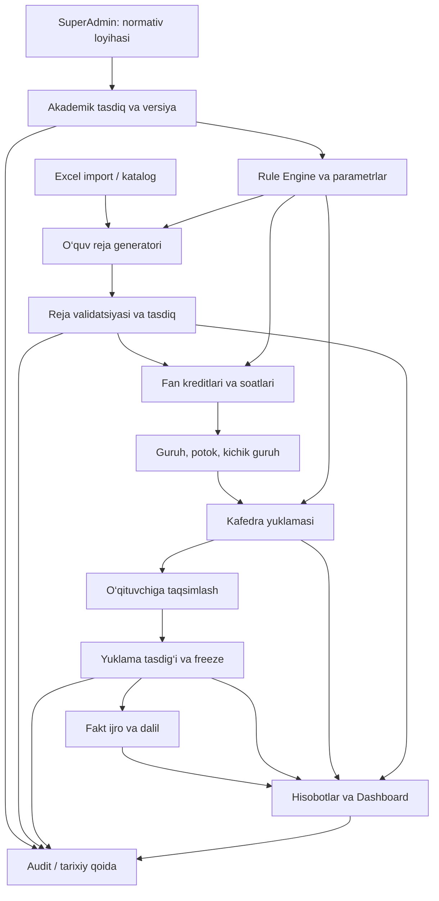
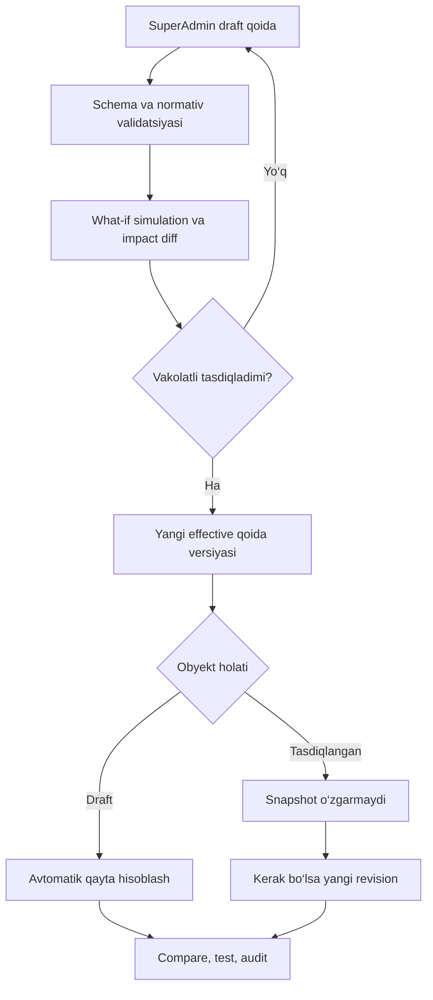
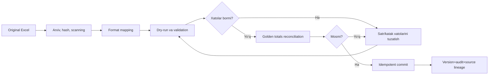

# 12. Arxitektura va biznes oqim sxemalari

## 12.1. Umumiy hisoblash zanjiri (Mermaid)

## 12.2. Normativ o‘zgarganda (Mermaid)

## 12.3. Excel migratsiya (Mermaid)

## 12.4. Diagramma ma'nosi
Arizalar yoki Registrator ofisi ishtirok etmaydi. Bu yechim O‘quv bo‘limining ma’lumotlarni qabul qilish, rasmiy reja yaratish, o‘quv yuklamasini hisoblash, ijro va hisobot jarayonlarini bog‘laydi. Tasdiqlangan raqamlar o‘zgarmas snapshot; barcha me’yorlar versiya bilan.
